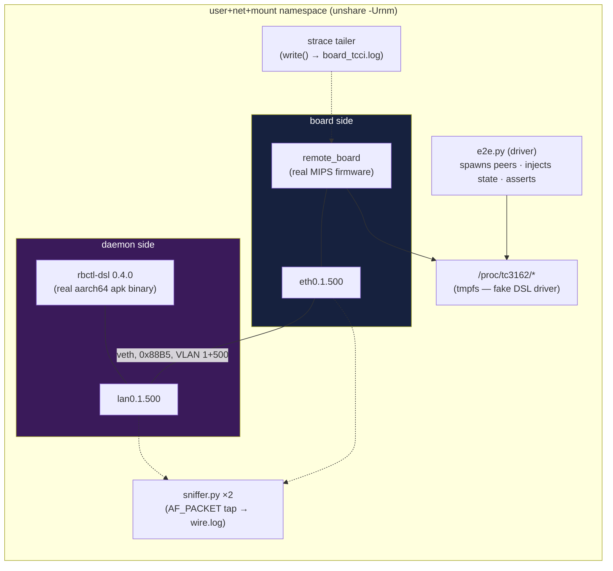
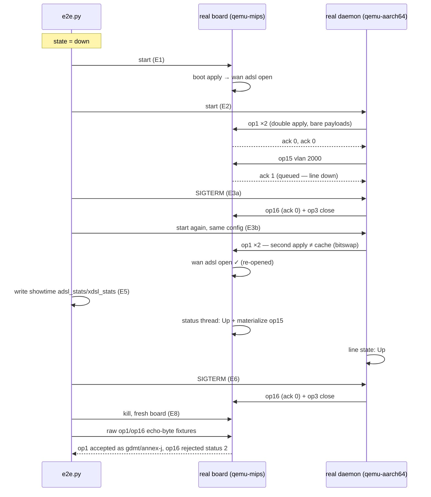

# E2E harness — the real board firmware against the real daemon, on a host

`tests/e2e/` runs the **actual MIPS `remote_board` firmware binary** and the
**actual aarch64 `rbctl-dsl` daemon build** against each other, over a real
Ethernet wire, entirely on a development host. No board hardware, no DSLAM,
no new host dependencies beyond `qemu-user` and `strace`.

It exists because two field-test rounds were lost to a bug class that unit
tests structurally cannot catch: the daemon's test mock shared the daemon's
own misunderstanding of the wire format. Here, every frame the daemon
produces is judged by the firmware whose logic we reverse-engineered —
the frames are either understood or they are not, and both outcomes are
asserted.

> Design and rationale: the
> [wire-format & bring-up fixes plan](../plans/wire-format-and-bringup-fixes-plan.md)
> §3.5. (The field-failure analysis and the extracted firmware artifacts
> it cites live in a private research tree that is **not part of this
> repository**.) Final result at the time of writing: **E1–E9b, ED, EX,
> EA all PASS** (including the warn-only watchdog check and the
> data-link scenarios added for 0.5.0).

---

## 1. How it works

Two qemu-user processes — the board binary (MIPS) and the daemon
(aarch64) — are placed in a private Linux namespace and connected by a
veth pair. qemu-user translates each binary's machine code to the host
CPU while letting **real Linux syscalls through**: `socket(AF_PACKET)`,
`send`, `recv` are genuine kernel operations, so the `0x88B5` Ethernet
traffic between the two peers is real, capturable, and checksum-verified
by the real firmware.



The pieces:

| Piece | File | Role |
|---|---|---|
| Entry point | [`run.sh`](../rbctl-feed/rbctl-dsl/tests/e2e/run.sh) | prerequisite check + namespace entry |
| Environment builder | [`inner.sh`](../rbctl-feed/rbctl-dsl/tests/e2e/inner.sh) | mounts, veth/VLANs, sysroots, stubs — runs *inside* the ns |
| Scenario driver | [`e2e.py`](../rbctl-feed/rbctl-dsl/tests/e2e/e2e.py) | spawns/stops peers, injects line state, runs assertions |
| Wire recorder | [`sniffer.py`](../rbctl-feed/rbctl-dsl/tests/e2e/sniffer.py) | AF_PACKET tap per veth end → text wire log |
| Protocol library | [`proto.py`](../rbctl-feed/rbctl-dsl/tests/e2e/proto.py) | frame build/parse + CRC-16/ARC + raw replay client |
| Fake driver files | (runtime) | tmpfs `/proc/tc3162/*` served by `inner.sh`/`e2e.py` |

### 1.1 The wire: why stacked VLANs

The firmware binds the **literal interface name `eth0.1.500`** (hardcoded
in `msg_initServer`). The daemon side is configured as `lan0.1.500`.
Both ends must strip the same tags or frames never match the BPF
filters, so the harness builds:

```
eth0 (veth end, MAC 00:aa:bb:01:23:48 — the boot MAC the firmware expects)
 └─ eth0.1    (VLAN id 1)
     └─ eth0.1.500  (VLAN id 500)   ← board's management socket
lan0 (veth peer)
 └─ lan0.1    (VLAN id 1)
     └─ lan0.1.500  (VLAN id 500)   ← daemon's board socket
```

One fixed board MAC matters: the firmware sets `00:aa:bb:01:23:48` on
`eth0.1` at boot (its own `ifconfig` call fails under qemu, so the
harness pre-sets it on the veth end — VLAN children inherit it).

### 1.2 The fake `/proc/tc3162` (the only simulated piece)

On real hardware these files are created by the `tc3162` DSL kernel
driver probing EN7516 SoC registers and a DSL DSP/AFE — silicon qemu has
no device model for, and the OEM kernel cannot boot under qemu-system at
all. The firmware's interface to that hardware is **plain text files**,
so the harness fabricates exactly that interface on tmpfs:

| File | Direction | Harness behavior |
|---|---|---|
| `tcci_cmd` | board writes | **Losslessly captured** via strace (§1.3) |
| `xdsl_stats` | board reads | `"<status>:<type>"` (**colon** — the real `tccicmd.ko` format): `0:3` = down, `1:2` = showtime/VDSL2, `1:1` = showtime/ADSL. The board's `apiGetXdslStatus` strtok's on `:`; a space separator silently disables the op5/op15 direct materialization path (session-4 finding) |
| `adsl_stats` | board reads | full telemetry text (link state, Opmode, per-direction rates/SNR/attenuation, error counters); the harness rewrites it to inject showtime (PTM and ADSL variants) |
| `vdsl_interface_config` | board reads | `CurrentProfiles: 17a` |
| `/proc/modules` | board reads | swaps with the injected line family: `mt7510ptm` (PTM data path) / `mt7510sar` (ATM — drives `dsl_isAtmConnection`) |

Everything else is genuine: the OEM rootfs (uClibc loader + libs), the
firmware's config cache, its dispatch/dedup logic, its status thread, the
frame CRC checks, the daemon's full state machine.

### 1.3 Lossless `tcci_cmd` capture via strace

The board writes each chipset command as `fopen("w") + fputs + fclose` —
an apply burst is 4–6 commands within microseconds, so a tmpfs file only
ever holds the *last* one (polling collapses bursts; this exact race ate
the first harness iteration). Instead the board is launched under
`strace -f -e trace=openat,write`, and a tailer thread in `e2e.py`
reconstructs the command stream:

```
strace log:                                          board_tcci.log:
[pid N] openat("/proc/tc3162/tcci_cmd", O_WRONLY)=2  ┐ fd 2 is tcci
[pid N] write(2, "wan adsl opencmd vdsl2", 21)       ┼→ wan adsl opencmd vdsl2
[pid N] close(2)                                     ┘
```

Every `write()` is one syscall → the trace is complete by construction.
The same stream doubles as the **ground truth for open/close/dedup
assertions**: "did this op1 take the apply path?" is answered by whether
a `wan adsl open` burst appears, not by anything the daemon reports.

(A FUSE-based and an `LD_PRELOAD`-based capture were prototyped and
dropped: the former needed a library install, the latter broke on the
space in the repo path plus a uClibc/musl ABI mismatch. strace needed
neither.)

### 1.4 The aarch64 sysroot

The daemon cannot be built natively for the host (it links
libuci/libubox/libnl-tiny from the OpenWrt SDK, aarch64-only) — so the
harness runs the **same binary the tester flashes**, under
`qemu-aarch64 -L`, against a sysroot composed at runtime from the SDK
staging dirs (`root-mediatek/lib` musl loader + `usr/lib/*.so` + the
binary from `build_dir/.../ipkg-.../usr/sbin/rbctl-dsl`).

---

## 2. Requirements & running

Host packages (all standard):

- `qemu-user` (`qemu-mips`, `qemu-aarch64`)
- `strace`
- `iproute2` (`ip`)
- `python3` ≥ 3.8 (stdlib only)
- kernel allowing unprivileged `unshare -Urnm` (user+net+mount
  namespaces; default on most desktop distros)

Inputs outside this repository (both are **private artifacts**, not
distributed with the repo — the harness takes them via environment
variables and refuses to run without them):

| Env var | Meaning |
|---|---|
| `ECONET_ROOTFS` | the extracted OEM firmware rootfs (uClibc loader, libs, `userfs/bin/remote_board`) |
| `OPENWRT_ROOT` | an OpenWrt SDK/build tree containing the daemon build and target libs |
| `DAEMON_BIN` | *(optional)* explicit daemon binary; default = newest `rbctl-dsl-*` ipkg binary found under `$OPENWRT_ROOT/build_dir/` |

Personal paths never live in the scripts. For repeat runs, put the
exports in `tests/e2e/env` (sourced by `run.sh` if present; gitignored):

```sh
# tests/e2e/env  — not committed
export ECONET_ROOTFS="$HOME/path/to/econet_rootfs"
export OPENWRT_ROOT="$HOME/path/to/openwrt"
```

```sh
# default suite (~90 s)
tests/e2e/run.sh

# subset / single scenario
SCENARIOS='E1 E2' tests/e2e/run.sh
```

Exit code 0 = all scenarios passed. Each run leaves a log directory
(`[e2e] logdir: /tmp/rbctl-e2e.XXXXXX` on stdout) containing:

| File | Content |
|---|---|
| `board_tcci.log` | decoded chipset commands (ground truth) |
| `board_sys.log` | `system()` shell commands (stubs; nas8 provisioning) |
| `board_<tag>.log` | firmware stdout/stderr (its own cache-diff debug) |
| `board_strace_<tag>.log` | raw strace |
| `daemon_<tag>.log` | daemon logs (banner, bring-up, line states) |
| `wire.log` | decoded frames from both taps, tagged `b_`/`h_` |

---

## 3. The scenarios

| # | Scenario | Proves (against real firmware) |
|---|---|---|
| **E1** | fresh board boots alone | boot config applies against the **zeroed** cache → full setter burst → `wan adsl open`; the line self-trains at board boot (why "power-cycle to prove the line is good" works) |
| **E2** | daemon starts on fresh board | wire: exactly two op1 requests with **bare 12-byte descriptors** (no echo byte), modulation/annex/profiles at the right offsets, acks `0`; board: `wan adsl opencmd vdsl2` burst + `wan adsl open` — the double apply |
| **E3** | daemon stop → restart, same config | shutdown = op16 **3-byte payload, ack 0** (was ack 2 with the bug) + op3 `wan adsl close`; restart with the *identical* config re-opens the line (second apply differs in exactly the bitswap byte — the session-1 "zombie" killer) |
| **E5** | harness injects showtime | board's 2-s status thread flips, the **queued op15 materializes** (real `system()` nas8/smuxctl commands run via stubs), daemon observes `line state: Up` with rates parsed from the synthetic `adsl_stats` (12/40 Mbps) |
| **E6** | daemon stop after showtime | teardown after materialization: op16 ack 0, line closed |
| **E7** | 30 s of continuous NoSignal | warn-only watchdog: exactly one "line silent" diagnostic (with the `restart-line` hint) and **zero** board-side tcci activity — no re-apply, no close |
| **E8** | raw replay of session-2 frames | the captured broken payloads against a fresh board: shifted op1 → board configures **G.DMT annex J** and acknowledges (the silent-garbage trap), shifted op16 → **status 2** rejection. The bug, reproducible forever |
| **E9/E9b** | config validation | impossible transport combo (adsl+ptm) aborts at load; 7 invalid data-link UCI configs rejected with the rule named (stable-index, dup vid/index, one-untagged, pbit range, `ptp` typo) |
| **ED** | two-link daemon config | UCI ptm sections vid 100 + vid 836 → both op15s queued **at open** with correct board-tag payloads → both materialize at the up-transition (`smuxctl add … 3 <vid>`), both host VLANs announced, teardown op16s both |
| **EX** | op15 materialization semantics | queue-at-down → transition materialization (full `smuxctl`/`vconfig`/`brctl` command set, smux mode 1 untagged vs 3 tagged) **and** the post-up direct path — both board flows verified |
| **EA** | auto-mode type swap | `line_mode auto` queues optimistic untagged PTM at open; an injected ADSL2+ showtime (with `mt7510sar` loaded) triggers the swap: op16 the queued PTM node + op5 (default PVC) with the F3 post-up warning logged |

The harness **pre-creates** the 24 interfaces the board's `ptmCreateVLAN`
polls for (`nas8_<pvc>`, `eth0.1.<2000+pvc>`, `br<pvc+2>` for pvc 0–7):
under qemu-user the board's absolute-path `vconfig`/`smuxctl` execs fail
and the PATH stubs are no-ops, so nothing would materialize without them —
`ptmCreateVLAN` would return 1, the handled flag would never set, and op16
would silently skip the teardown (see the quirks section of
[xdsl/data_plane.md](xdsl/data_plane.md)).

Scenario sequencing (default run):



---

## 4. File-by-file reference

### [`run.sh`](../rbctl-feed/rbctl-dsl/tests/e2e/run.sh) — entry point
Checks prerequisites (`qemu-mips`, `qemu-aarch64`, `strace`,
`unshare`), then `exec`s `unshare -Urnm --fork --kill-child bash
inner.sh`. `--kill-child` guarantees the qemu processes die with the
harness even on assertion crashes.

### [`inner.sh`](../rbctl-feed/rbctl-dsl/tests/e2e/inner.sh) — environment builder (runs inside the ns)
1. `mount -t sysfs` — **required**: without a private sysfs mount,
   `/sys/class/net` still shows the host's interfaces (sysfs is not
   netns-aware by default) and the daemon's carrier/MAC probing
   (`/sys/class/net/<iface>/…`) fails with ENOENT.
2. tmpfs over `/proc` + the fake `tc3162` files + `/proc/modules`.
3. tmpfs `/run` (daemon PID/IPC files).
4. The veth + stacked VLANs of §1.1, all links set UP, board MAC set.
5. `STUBBIN` shell stubs (`ifconfig`, `brctl`, `vconfig`, `smuxctl`,
   `route`) — the firmware's `system()` calls succeed and are recorded
   to `board_sys.log` (this is how E5 proves `nas8` provisioning ran).
6. The aarch64 sysroot (§1.4).
7. `exec python3 e2e.py`.

### [`e2e.py`](../rbctl-feed/rbctl-dsl/tests/e2e/e2e.py) — scenario driver (also the assertion suite)
- **Peer control** — `start_board` (qemu-mips under strace, own process
  group so SIGTERM reaches the emulator, not just strace),
  `start_daemon` (qemu-aarch64, SIGTERM to exit), `kill_board` (group
  signal), `stop_daemon` (waits for clean exit).
- **strace tailer** (§1.3) — background thread; `openat` lines with
  `O_WRONLY` on `/proc/tc3162/*` register `(pid, fd)`; matching
  `write(fd, "…")` lines are unescaped and appended to
  `board_tcci.log`. Partial lines are buffered until newline, files are
  followed incrementally.
- **State injection** — `set_line_state("down" | "showtime_ptm")`
  rewrites the tmpfs files; the board's next 2-s poll reads the new
  state.
- **Assertions** — `wait_file_contains` (log/tcci gating) plus direct
  parsing of `wire.log` via `proto.parse_wire_log`: payload lengths,
  byte layouts (`f.payload[0] == 6` …), ack words, per-seq pairing of
  request↔response. Every wire assertion encodes a fact from the
  disassembly (see the comments).
- **E8 replay** — `proto.RawClient` on `lan0.1.500` with a distinct
  host MAC; the two session-2 payload hex constants live here as
  permanent fixtures.

### [`proto.py`](../rbctl-feed/rbctl-dsl/tests/e2e/proto.py) — protocol library
- `crc16_arc` — CRC-16/ARC (poly 0xA001, init 0, reflected); verified
  against the crate's `0x1ea0` test vector.
- `build_frame` — 24-byte header + payload. **Coverage**: the CRC is
  computed over `frame[0x0E..0x16]` (magic, opcode, seq, payload_len)
  **plus two zero bytes standing in for the checksum field** plus the
  payload — matching `rbctl_proto::checksum`. (Getting this region
  wrong produces exactly the "board never answers" symptom: the firmware
  drops CRC failures silently.)
- `parse` / `parse_wire_log` — frame decoding for assertions.
- `RawClient` — request/response with seq matching and retransmit, for
  the E8 fixtures.

### [`sniffer.py`](../rbctl-feed/rbctl-dsl/tests/e2e/sniffer.py) — wire tap
Plain AF_PACKET raw socket bound per interface (`0x88B5`), two
instances (one per veth end) writing tagged lines to `wire.log`. Both
ends are tapped because each raw socket sees only its own side's
traffic: the daemon's requests are visible as `b_REQ` from the board
tap, responses as `h_RESP` from the daemon tap.

---

## 5. Design notes & gotchas (read before touching)

- **Why not qemu-system / full firmware boot**: the OEM kernel needs the
  TrendChip/EN7516 bootloader contract qemu has no machine model for,
  and the DSL "hardware" is proc-file text anyway — a full-system setup
  would replicate this same fake inside a kernel device model at far
  greater cost. See the plan §3.5 discussion.
- **Interface names are load-bearing**: the firmware literally binds
  `eth0.1.500`; rename via `ip link set … name` before creating the
  VLAN stack.
- **Board MAC**: pre-set `00:aa:bb:01:23:48` on the veth end (VLAN
  children inherit it); the firmware's own `ifconfig … hw ether` fails
  harmlessly under qemu.
- **Space in the repo path** (`Analisi remote_board`) breaks
  `LD_PRELOAD` (uClibc splits at spaces) — one reason the strace
  capture was chosen; the qemu `-L` sysroot argument handles spaces
  fine.
- **strace `-s 8192`**: the default 32-byte string limit truncates
  `write()` bodies; commands are short but the profile line is long.
- **Signal semantics**: qemu-user forwards signals to the *guest*, but a
  SIGTERM delivered to strace alone leaves the tracee running — hence
  `start_new_session` + `os.killpg` in the driver.
- **The firmware's own debug output** (`board_*.log`) is gold: it prints
  live cache-diff decisions (`pMsg->bitswap[1] != l_lastDslCfg.bitswap[0]`),
  an independent confirmation of the dedup analysis.
- **Adding a scenario**: write `eX_foo(board, …)`, add to the dispatch
  in `main()`, follow the pattern *drive state → wait for observable →
  assert on wire/tcci/logs*. Assert on at least one board-side
  observable (`board_tcci.log` or wire acks), never only daemon logs.

## 6. CI integration

Fast enough for CI (default suite ≈ 90 s wall) provided the runner
allows unprivileged user+net namespaces (rootless containers qualify
when `kernel.unprivileged_userns_clone=1`; Docker's default container
does **not** — needs `--security-opt seccomp=unconfined` or a privileged
runner). Exit code is the single gate. Suggested job:

```yaml
e2e:
  script:
    - apt-get install -y qemu-user strace iproute2
    - tests/e2e/run.sh
```

All scenarios run in the default suite; E7 is now a fast (~40 s)
warn-only check since the watchdog no longer acts on the line.
