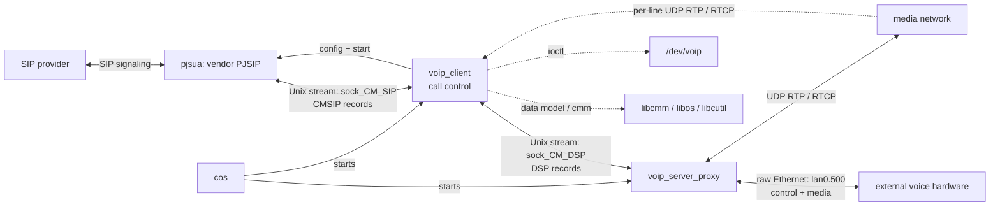

# Master-board architecture and startup

[VoIP index](index.md) · [Proxy](master-proxy.md) · [CMSIP](cmsip.md) · [Replacement](replacement.md)

## Scope and evidence

This document covers the AArch64 Linux master board. Binary observations use
Ghidra and the extracted firmware at `vx830v/squashfs-root/`; absolute Ghidra
addresses and binary identity notes are in [map.md](map.md). This is static
analysis, not a runtime trace. The external voice device is treated as a peer
whose host-facing contract must be preserved.

The diagram summarizes observed sockets, functions and imports; it does not
specify the complete audio flow for every call mode.

The dotted media input belongs to the client itself: `voip_select_socks_thread`
(`410e94`) reads per-line RTP/RTCP sockets and passes received data to
`4428a4`. The `usbvm rtp ipv4/ipv6` diagnostics suggest a USB voicemail
path. The socket reads are evidence; the exact feature conditions and audio
destination are not established. Ordinary DD03 relay traffic uses the proxy.

## Host programs

| Program | Role supported by first-pass evidence |
|---|---|
| `usr/bin/voip_client` | Call-control state machine; connects to DSP proxy, serves CMSIP, starts and monitors PJSUA, receives configuration through vendor libraries. |
| `usr/bin/voip_server_proxy` | Serves the local DSP socket and bridges control and media to the external peer. Despite its name, it is not shown to be a SIP proxy. |
| `usr/bin/pjsua` | Vendor-modified SIP user agent. Its disclosed sources include the CMSIP IPC extension. |
| `bin/cos` | The decompiled initialization routine launches proxy, waits one second, then launches client. |
| `usr/bin/remote_board` | General board management daemon; launched separately by `rcS`. Its established DSL protocol should not be assumed to be the VoIP protocol. |
| `lib/modules/voip.ko` | Character-device module for `/dev/voip`; the client uses ioctls. The complete ABI and necessity for a replacement are unverified. |

`voip_client` links vendor `libos.so`, `libcmm.so`, `libcutil.so`,
`libcalllog.so` and `libusbvmcommon.so`, among others. The proxy dynamically
depends only on `libgcc_s.so.1` and `libc.so`. PJSUA imports `libos.so` and
`libusbvmcommon.so` in addition to the runtime libraries. See [map.md](map.md).

## Startup and local IPC

1. `etc/init.d/rcS` sources `/etc/config.bba`. This build sets
   `INCLUDE_VOIP=y`, `INCLUDE_VOIP_REMOTE=y`, interface `lan0`, and VLAN `500`.
   It starts `remote_board` on `lan0.500` and starts `cos`.
2. The Ghidra `cos` initialization routine at `0x00406398` invokes
   `voip_server_proxy &`, waits one second, then invokes `voip_client &`.
3. Proxy `main` starts control and initialization threads, starts the media
   relay and listens on `/var/tmp/sock_CM_DSP`. It accepts one client at a
   time. The remote initialization code uses `/var/tmp/remote_init` as a
   marker; [boot dependencies](board-link.md#boot-dependencies) distinguish
   nonzero init status from retry exhaustion.
4. Client `main` **connects** to `sock_CM_DSP`, **listens** on
   `/var/tmp/sock_CM_SIP`, and starts a `select()` thread. It waits while the
   remote-init marker exists. The loop accepts one PJSUA connection and reads
   fixed-size records from both sockets.
5. When the relevant interface is available, `voip_start_pjsip` constructs a
   `pjsua --config-file /var/tmp/cmsip.conf ... &` command. It adds bound
   interface/address and mark arguments as appropriate. The precise config
   contents and restart state machine remain to be mapped.

The startup script also mentions `voip_server` in the branch where remote VoIP
is disabled; that branch is not selected by this extracted configuration and
the executable is absent from the master root filesystem.

Separately, [rcS](../../vx830v/squashfs-root/etc/init.d/rcS) lines 325–337
enable four mixer switches under `D2_DSP`, create `/var/tmp/osal`, and, after
a three-second delay, invoke `taskset 8 ve_vtsp_main &`. These commands are
outside the `voip_server` conditional. No `ve_vtsp_main` executable was found
in the extracted master rootfs. The script establishes an attempted launch,
not a running process or a dependency of the remote voice board.

## Other master-side integration

The event loop calls `msg_recv` and the client imports configuration/data-model
functions. Its strings include SIP account configuration, registration, call
logs, voicemail and line features. A replacement needs either compatible
management integration or a deliberate new configuration interface; feature
parity is not established by strings alone.

`voip_client` also opens `/dev/voip`. Observed ioctl requests include
`0x40347600`, `0x40047609`, `0x40347601` (in `4165f8` and `415908`) and
`0x40347602` (in `416be8` and `415908`). These are host device requests,
distinct from the DSP command numbers. `rcS.model` creates the device with major 214, minor 0. What these ioctls
do and whether they are essential remain open. `nf_conntrack_sip.ko` and
`nf_nat_sip.ko` are separate SIP/NAT helpers, not the call controller.
