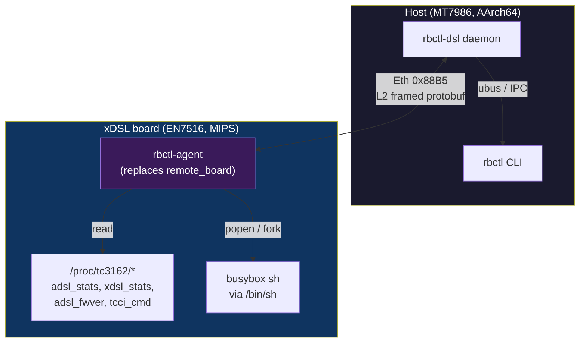
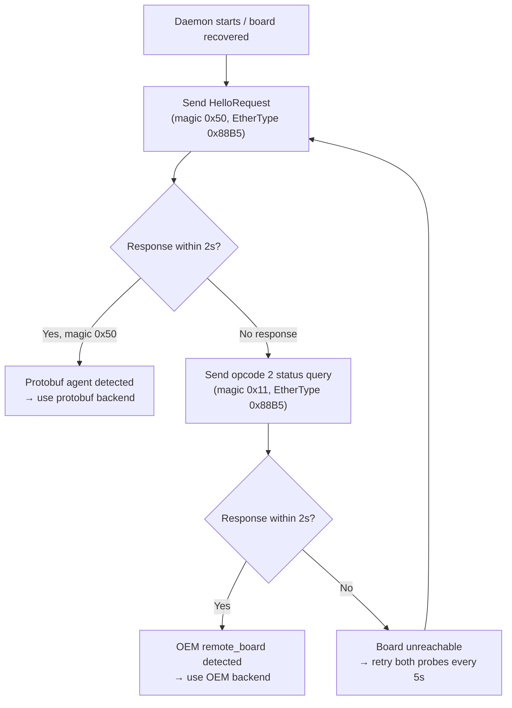

# rbctl xDSL board protocol — protobuf over L2

Design for a new protocol between the host (`rbctl-dsl` daemon) and the EcoNet
xDSL board, intended to **replace** the board-side `remote_board` binary with a
custom agent. Uses **Protocol Buffers** for serialization and runs directly on
**Layer 2** (EtherType) since the board has no IP address.

## Motivation

The OEM protocol (EtherType `0x88B5`, fixed binary payloads) is fully reverse-
engineered but limited:

- Opacity — fixed binary structs, no extensibility, no schema
- Data scarcity — only ~13 aggregate metrics exposed; 40+ fields locked inside
  the DSL driver (`/proc/tc3162/*`) never reach the host
- No remote shell — the board runs Linux but there is no SSH/telnet path from
  the host (the board has no IP stack reachable from the host)
- Control quirks — opcode 1 doubles as the **only** way to open the line (its
  apply path ends in `wan adsl open`) but is silently deduplicated against an
  **unreadable** board-side config cache (status 0, no side effects, no open),
  so guaranteeing an open requires the double-apply trick (two op1s differing
  in exactly the bitswap byte); "retrain" is a client-side close + delay +
  double-apply sequence rather than a command; the up/down/closed state is
  not readable back; and neither the cached config nor the requested data
  links can be queried. The protobuf protocol replaces all of this: an
  idempotent `line_open` that reports what happened (opened? config
  applied?), a cache-hit flag on config responses, `CLOSED` as a `LinkState`
  case, a proper `line_retrain`, and a `get_config` readback (see
  [Config](#config-replaces-opcodes-1-356-1516)).

This protocol solves all three by using protobuf (self-describing, extensible)
and adding an optional remote shell channel.

## Design constraints

| Constraint | Detail |
|-----------|--------|
| **No IP** | Board has no IP address; communication is L2 only |
| **EtherType** | Use `0x88B5` (same as OEM) for coexistence during migration, or a new locally-administered EtherType |
| **Transport** | Same raw `AF_PACKET` socket as OEM — no TCP/UDP |
| **Fragmentation** | MTU is ~1500 bytes; large protobuf messages must be chunked |
| **Binary size** | Agent must fit in the board's flash (alongside kernel + rootfs) |
| **Coexistence** | During migration, the agent replaces `/userfs/bin/remote_board` in the `2RDH` image |
| **Toolchain** | Rust + `prost` (protobuf compiler), cross-compiled for `mips-unknown-linux-musl` |

## Protocol layers



## L2 framing

Reuse the existing 24-byte `proto_frame_hdr` (from the OEM protocol) as the L2
envelope, but replace the payload with protobuf-encoded bytes:

```
Offset  Size  Field
0x00    6     dst MAC (board MAC or broadcast for discovery)
0x06    6     src MAC (host interface MAC)
0x0C    2     EtherType 0x88B5 (big-endian)
0x0E    1     magic: 0x50 (PROTOBUF marker, ASCII 'P', distinguishes from OEM 0x11/0x10)
0x0F    1     message_type (see enum below)
0x10    4     sequence (big-endian u32)
0x14    2     payload_len (big-endian u16, protobuf bytes from 0x18 onward)
0x16    2     checksum (CRC-16/ARC, same algorithm as OEM)
0x18    ..    protobuf-encoded Request or Response message
```

The `magic` byte `0x50` (ASCII `'P'` for Protobuf) distinguishes protobuf
frames from OEM frames
(`0x11` command / `0x10` response). This allows the host daemon to support
both protocols simultaneously during migration.

### Why the header is not redundant with protobuf

Protobuf is a **pure serialization format** — it encodes structured data as
bytes and decodes bytes back. It does **not** provide:

| Feature | Protobuf | L2 header | Needed? |
|---------|----------|-----------|---------|
| **Integrity check** | None | CRC-16/ARC | Yes — Ethernet FCS is stripped by NIC before userspace sees the frame |
| **Frame length** | None (stream-oriented) | `payload_len` (u16) | Yes — receiver must know how many bytes to read from a raw socket |
| **Duplicate detection** | None | `sequence` (u32) | Yes — retransmissions can produce duplicate frames |
| **Protocol dispatch** | None | `magic` (0x50) | Yes — distinguish protobuf from OEM on same EtherType |
| **Request/response correlation** | `id` field in messages | `sequence` | Belt-and-suspenders: protobuf `id` handles app-level, header `seq` handles transport-level |

Without the header, a corrupted frame would be fed directly to the protobuf
decoder, which may produce silently wrong data or a cryptic parse error with
no indication of which byte was corrupted.

### EtherType safety — no VoIP conflict

Confirmed via Ghidra analysis of `voip_server_proxy` (host-side AArch64).
The board also runs VoIP daemons, but they use **completely different
EtherTypes**:

| EtherType | Protocol | Magic | Used by |
|-----------|----------|-------|---------|
| `0x88B5` | Board management (OEM + our protobuf) | `0x11`/`0x10` (OEM), `0x50` (protobuf) | `remote_board` |
| `0x88B6` | cmm message bus | varies | management traffic |
| `0xDD01` | Host request and peer status reply | host `0x11`, peer `0x10` | voice proxies |
| `0xDD02` | Peer event and host status reply | host `0x11`, peer `0x10` | voice proxies |
| `0xDD03` | RTP/RTCP datagrams in either direction | host `0x11`, peer `0x10` | voice proxies |

On the master, `voip_client` exchanges DSP records with `voip_server_proxy`
over the Unix stream socket `/var/tmp/sock_CM_DSP`. The proxy owns the three
voice EtherTypes on `lan0.500` (VLAN 500). DD01 and DD02 identify the
transaction initiator: each reply uses the same EtherType as its request.
See the [board-link contract](../docs/voip/board-link.md) and [Econet peer](../docs/voip/peer.md).

Our protobuf protocol uses EtherType `0x88B5` + magic `0x50` ('P' for
Protobuf), distinct from the OEM management markers and all three voice EtherTypes.

### Protocol auto-detection

The host daemon must work with **either** the OEM `remote_board` **or** the
new protobuf agent, without user configuration. Detection happens at daemon
startup and after any board reboot/recovery:



**Why this works:**
- The OEM `remote_board` checks the magic byte at frame offset `0x0E`. It
  only accepts `0x11` (command) and `0x10` (response). A frame with magic
  `0x50` is **silently dropped** — no error response, no crash.
- The protobuf agent checks for magic `0x50`. An OEM frame (magic `0x11`)
  is silently dropped.
- Both protocols share EtherType `0x88B5`, so a single `AF_PACKET` socket
  receives all frames. The magic byte is the dispatch key.

**Detection triggers:**
1. **Daemon startup** — initial probe before configuring the DSL line
2. **After firmware upgrade** — `complete` stage 3 response → re-probe (the
   board may now run the new agent)
3. **After board recovery** — board comes back online after reboot → re-probe
4. **Polling timeout** — if the board stops responding to the active
   protocol, fall back to re-detection

**State persistence:** the daemon remembers the detected protocol for the
session. Re-detection only happens on the triggers above, not on every poll.

### Fragmentation

Protobuf messages larger than one frame's payload capacity (~1462 B after
the 24-byte header and the 8-byte sub-header below) are split across
multiple frames:

* Bit `0x80` of the **message_type byte** marks the frame as
  fragmented; the type itself lives in bits 0-6 and the magic byte stays
  a pure constant `0x50`. One read of `0x0F` answers both "what is this"
  and "is it a fragment" — the quick-parse case — without the draft's
  collision (the fragment *index* once shared this byte's low nibble
  with `message_type`, making a REQUEST fragment #3 bit-identical to an
  EVENT). The index moved into the sub-header below, and only the single
  flag bit remains in `0x0F`, masked out of the type.
* Each fragmented frame's payload begins with an 8-byte sub-header:

| Offset | Size | Field |
|--------|------|-------|
| `0x00` | 2 | fragment_index (u16 BE, 0-based) |
| `0x02` | 2 | fragment_count (u16 BE, total frames in the message) |
| `0x04` | 4 | message_length (u32 BE, reassembled size) |

* All fragments of one message share the frame `sequence` value (the
  reassembly key, also the retry correlation).
* **Capacity**: 65535 fragments × ~1462 B ≈ 96 MB. A 35b spectrum
  (8192 tones ≈ 24 KB) takes 17 frames — the draft's 4-bit index capped
  at ~23 KB and overflowed on 35b; that limitation is retired.

Reliability (v1 — matching the OEM retry philosophy; the link is a
private point-to-point Ethernet where loss is rare):

* **Message-level retry.** The receiver reassembles by sequence; if not
  all `fragment_count` frames arrive within a reassembly timeout
  (500 ms), partial state is dropped and the sender's normal retry
  (by sequence, like the OEM protocol) resends the whole message.
  Re-sending ~24 KB costs ~2 ms of wire time on 100 Mbps — per-fragment
  acks are not worth their complexity yet. Upgrade path if the link
  proves lossy: selective fragment acks as a new `message_type`.
* **TX budget.** A sender (agent or host) emits at most a small quantum
  of fragments per event-loop turn (e.g. 4) and services incoming
  traffic between quanta, so a spectrum or shell burst never delays a
  1 Hz poll reply. Firmware streaming on the host side follows the same
  rule.
* The receiver validates `message_length` against a sanity maximum
  (e.g. 1 MB) before allocating — a malformed sub-header cannot OOM the
  peer.

## Message types

```protobuf
syntax = "proto3";

package rbctl.v1;

// ─── Envelope: every frame carries one of these ───────────────────────

enum MessageType {
  MESSAGE_TYPE_UNSPECIFIED = 0;
  REQUEST                  = 1;
  RESPONSE                = 2;
  EVENT                   = 3;   // async push from board to host
}

// ─── Request ──────────────────────────────────────────────────────────

message Request {
  uint32 id = 1;                    // correlation ID (host-assigned)
  oneof payload {
    HelloRequest           hello          = 10;
    GetLineStatusRequest   line_status    = 11;  // basic — daemon poll
    GetLineMetricsRequest  line_metrics   = 12;  // full — ubus/IPC
    LinkRequest            link           = 13;  // data-link CRUD
    ConfigRequest          config         = 14;  // line config/open/close/retrain
    FirmwareRequest        firmware       = 15;
    ShellRequest           shell          = 16;
    GetSpectrumRequest     spectrum       = 17;  // incl. diagnostics trigger
    GetBoardInfoRequest    board_info     = 19;
    GetConfigRequest       get_config     = 20;
  }
}

// ─── Response ─────────────────────────────────────────────────────────

message Response {
  uint32 id = 1;                    // matches Request.id
  bool   ok = 2;                    // true on success
  string error = 3;                 // human-readable error if !ok
  oneof payload {
    HelloResponse          hello          = 10;
    LineStatusResponse     line_status    = 11;  // basic
    LineMetricsResponse    line_metrics   = 12;  // full
    LinkResponse           link           = 13;
    ConfigResponse         config         = 14;
    FirmwareResponse       firmware       = 15;
    ShellResponse          shell          = 16;
    SpectrumResponse       spectrum       = 17;
    BoardInfoResponse      board_info     = 19;
    ConfigDataResponse     config_data    = 20;
  }
}

// ─── Event (async, board → host) ──────────────────────────────────────

message Event {
  oneof payload {
    LinkStatusEvent  link_status = 1;
    FirmwareProgress fw_progress = 2;
  }
}
```

## Message definitions

### Hello / Discovery

```protobuf
message HelloRequest {}

message HelloResponse {
  string  agent_version     = 1;   // agent build version
  string  board_hw_version  = 2;   // from /proc/tc3162/ or SoC ID
  string  dsl_fw_version    = 3;   // from /proc/tc3162/adsl_fwver
  string  kernel_version    = 4;   // uname -r
  uint32  uptime_secs       = 5;   // board uptime
  MacAddress board_mac      = 6;
  string  active_partition  = 7;   // "tclinux" or "tclinux_slave"
  RepeatedString capabilities = 8; // "shell", "spectrum", "vectoring", ...
}

message MacAddress {
  bytes mac = 1;  // 6 bytes
}
```

### Line status, basic (replaces opcode 2 — the daemon's poll)

The poll tier: just enough for the daemon's state machine at minimal agent
cost — one cheap `/proc` read, ~30 bytes on the wire, never fragmented.
The trained `modulation` is here deliberately: it is the authority for the
data-link type (PTM/ATM) derived at showtime.

```protobuf
message GetLineStatusRequest {}

message LineStatusResponse {
  LinkState      link_state  = 1;  // incl. CLOSED = administratively down
  ModulationType modulation  = 2;  // trained modulation (link-type authority)
  DataPath       data_path   = 3;  // ATM/PTM as reported by the driver
  AnnexType      annex       = 4;
  uint32         uptime_secs = 5;  // current showtime session
}
```

### Shared enums

```protobuf
enum LinkState {
  LINK_STATE_UNSPECIFIED = 0;
  NO_SIGNAL              = 1;  // operational down: no DSL signal
  HANDSHAKE              = 2;
  TRAINING               = 3;
  SHOWTIME               = 4;  // operational up
  CLOSED                 = 5;  // administratively down (line_close / OEM op3):
                               // not training — distinct from NO_SIGNAL
}

enum ModulationType {
  MODULATION_UNSPECIFIED = 0;
  ADSL_T1413             = 1;
  ADSL_GDMT              = 2;
  ADSL_GLITE             = 3;
  ADSL2                  = 4;
  ADSL2PLUS              = 5;
  VDSL2                  = 6;
  MULTIMODE              = 7; // config-only: auto-detect across standards
                              // (OEM code 7). Never appears in line status —
                              // the trained modulation is always concrete.
}

enum DataPath {
  DATA_PATH_UNSPECIFIED = 0;
  ATM                   = 1;
  PTM                   = 2;
}

enum AnnexType {
  ANNEX_UNSPECIFIED = 0;
  A                 = 1;
  B                 = 2;
  I                 = 3;
  M                 = 4;
  J                 = 5;   // OEM code 6
  AUTO              = 6;   // OEM code 8 — auto-negotiate (config-only)
  AL                = 7;   // OEM code 4 — multi-annex A+L
  ALM               = 8;   // OEM code 5 — multi-annex A+L+M
  BJ                = 9;   // OEM code 7 — multi-annex B+J
}
```

### Line metrics, full (absorbs opcode 4 — what ubus prints)

A strict superset of the basic status: all signal metrics, error counters,
per-channel (fast/interleaved, near/far) statistics, channel blocks,
retransmission (G.INP), far-end identification, vectoring, INP/delay and
band plan — everything except the per-tone spectrum. Absorbs the former
`line_stats` and `channel_stats` requests (opcode 4's two flavors):
parsing the full stats file on every poll would waste agent CPU for data
the daemon's state machine never looks at, so metrics are fetched when a
consumer asks (or on a slow background refresh).

```protobuf
message GetLineMetricsRequest {}

message LineMetricsResponse {
  // ── Rates (kbps) ──
  DirectionalU32  current_rate       = 10;
  DirectionalU32  attainable_rate    = 11;
  PerChannelRates per_channel_rates  = 12;

  // ── Signal metrics (dB × 10) ──
  DirectionalU32  noise_margin       = 20;  // SNR margin (down/up)
  DirectionalU32  attenuation        = 21;
  DirectionalU32  output_power       = 22;

  // ── Error counters (cumulative since link-up) ──
  DirectionalU32  crc_errors         = 30;
  DirectionalU32  fec_errors         = 31;
  DirectionalU32  hes_errors         = 32;
  PerChannelErrors per_channel_errors = 33;

  // ── Error seconds ──
  DirectionalU32  es = 40;  // errored seconds
  DirectionalU32  ses = 41; // severely errored seconds
  DirectionalU32  uas = 42; // unavailable seconds
  DirectionalU32  los = 43; // loss of signal seconds
  DirectionalU32  lof = 44; // loss of frame seconds
  DirectionalU32  lpr = 45; // loss of power seconds

  // ── Channel blocks (absorbs the old channel_stats) ──
  ChannelBlocks   channel_blocks     = 50;

  // ── Session uptime ──
  uint32          total_act_seconds  = 51;  // cumulative across sessions
  uint32          current_act_seconds = 52; // current session

  // ── Far-end identification ──
  FarEndInfo      far_end            = 60;

  // ── Vectoring / G.INP ──
  VectoringInfo   vectoring          = 61;
  GinpInfo        ginp               = 62;
  RetransmissionStats retransmission = 63;

  // ── INP / delay ──
  DirectionalU32  inp_symbols        = 70;  // impulse noise protection
  DirectionalU32  interleave_delay_us = 71;

  // ── VDSL2 ──
  uint32          vdsl2_profile_bitmask = 80;
  BandPlan        band_plan             = 81;

  // ── Raw timestamp ──
  uint64          stats_timestamp = 90;  // when the stats were read
}

message DirectionalU32 {
  uint32 downstream = 1;
  uint32 upstream   = 2;
}

message PerChannelRates {
  uint32 ds_fast        = 1;
  uint32 ds_interleaved = 2;
  uint32 us_fast        = 3;
  uint32 us_interleaved = 4;
}

message PerChannelErrors {
  PerChannelDirection near_end = 1;
  PerChannelDirection far_end  = 2;
}

message PerChannelDirection {
  uint32 crc_fast         = 1;
  uint32 crc_interleaved  = 2;
  uint32 fec_fast         = 3;
  uint32 fec_interleaved  = 4;
  uint32 hes_fast         = 5;
  uint32 hes_interleaved  = 6;
}

message ChannelBlocks {
  uint32 rx_blocks   = 1;
  uint32 rx_errors   = 2;
  uint32 rx_discards = 3;
  uint32 tx_blocks   = 4;
  uint32 tx_errors   = 5;
  uint32 tx_discards = 6;
}

message FarEndInfo {
  uint32 vendor_id        = 1;   // ATU-R vendor ID (EOC)
  bytes  vendor_id_raw    = 2;   // full 8-byte vendor ID
  uint32 standard_version = 3;   // ITU-T standard version code
  string vendor_name      = 4;   // decoded vendor name if known
  string country_code     = 5;   // if reported
}

message VectoringInfo {
  bool   enabled       = 1;
  bool   active        = 2;
  uint32 sync_detected = 3;   // G.vector synchronization
  string vector_profile = 4; // e.g. "R-Vector1_2"
}

message GinpInfo {
  bool   enabled        = 1;
  uint32 actual_inp     = 2;   // actual impulse noise protection
  uint32 dtu_tx_count   = 3;   // transmitted DTUs
  uint32 dtu_rx_count   = 4;   // received DTUs
  uint32 dtu_err_count  = 5;   // errored DTUs
}

message RetransmissionStats {
  uint32 tx_dtu_count      = 1;
  uint32 rx_dtu_count      = 2;
  uint32 correct_dtu       = 3;
  uint32 errored_dtu       = 4;
  uint32 error_free_bits   = 5;
  uint32 min_throughput    = 6;   // min error-free throughput rate
  uint32 actual_throughput = 7;   // actual error-free throughput rate
  uint32 rein_value        = 8;   // REIN impulse noise value
  uint32 shine_value       = 9;   // SHINE impulse noise value
  uint32 act_delay_rtx_us  = 10;  // retransmission delay (µs)
}

message BandPlan {
  string        profile = 1;  // "17a", "30a", "35b", "12a", "8b", "8d"
  repeated Band bands   = 2;
}

message Band {
  uint32 index      = 1;
  uint32 start_tone = 2;
  uint32 end_tone   = 3;
  uint32 psd_max    = 4;  // dBm/Hz
  uint32 tone_count = 5;
}
```

### Spectrum data (NEW — per-tone graphs; absorbs diagnostics)

```protobuf
message GetSpectrumRequest {
  // Request specific data types
  bool snr_per_tone   = 1;
  bool bits_per_tone  = 2;
  bool hlog           = 3;   // loop transfer function
  bool qln            = 4;   // quiet line noise
  bool fresh          = 5;   // trigger a new Hlog/QLN measurement first
}

message SpectrumResponse {
  ToneData snr   = 1;   // SNR per tone (dB, ×100)
  ToneData bits  = 2;   // bit allocation per tone (0-15)
  ToneData gain  = 3;   // gain per tone
  ToneData hlog  = 4;   // Hlog per tone (dB, ×100)
  ToneData qln   = 5;   // QLN per tone (dBm/Hz, ×100)
  bool in_progress = 6; // measurement still running — refetch later
}

message ToneData {
  uint32 start_tone    = 1;
  uint32 tone_count    = 2;
  uint32 tone_spacing  = 3;   // kHz (4.3125 for ADSL, 8.0 for VDSL2 US0)
  // Packed values — one int32 per tone (big-endian on wire, protobuf handles encoding)
  repeated sint32 values = 4 [packed = true];
}
```

Hlog/QLN may require a fresh measurement (the driver caches the last one):
`fresh=true` triggers it and `in_progress` in the response says refetch
later. This absorbs the former separate diagnostics request — measurement
is inherently spectrum work.

> 35b spectra (8192 tones ≈ 24 KB) fit comfortably — fragmentation
> capacity is ~96 MB (see [Fragmentation](#fragmentation)).

### Line config & control (replaces opcodes 1, 3)

In the OEM protocol, opcode 1 is simultaneously "apply config" and "open the
line", but it is deduplicated against an unreadable board-side cache: an op1
identical to the cache returns status 0 with **no side effects and no open**.
Since the cache cannot be read, the host cannot know whether a given op1 will
open the line — so the daemon must always send two op1s differing in exactly
the bitswap byte (the second can never be deduped, so it always executes the
full apply path ending in `wan adsl open`). Retrain is worse: op3 (close)
followed by the double-apply, with a client-side delay for timing. And
nothing can read back whether the line is up, down or administratively
closed, nor which config and data links are active.

This protocol keeps the concerns separate and adds readback:

- `line_config` — params only, never opens. Reports cache hits
  (`applied=false`); errors if the line is closed (opening is `line_open`'s
  job, never an implicit side effect).
- `line_open` — like send-config, but explicitly intended to open the line
  if not already opened. One idempotent message replacing the double-apply
  trick; the response reports what actually happened.
- `line_close` / `line_retrain` — direct replacements for op3 and for the
  client-side close+delay+reopen sequence.
- `CLOSED` in `LinkState` (see line status) — the up/down/closed answer
  rides the regular status poll.
- `get_config` — reads back the active config + requested data links.

```protobuf
message ConfigRequest {
  oneof action {
    LineConfig line_config  = 1;  // params only; never opens
    LineOpen   line_open    = 2;  // apply config + ensure open
    LineOp     line_close   = 3;  // close (administratively down)
    LineOp     line_retrain = 4;  // atomic close + open, current params
  }
}

message LineConfig {
  // ── Basic (already in OEM opcode 1) ──
  ModulationType modulation     = 1;
  AnnexType      annex          = 2;
  bool           bitswap        = 3;
  bool           sra            = 4;
  uint32         vdsl2_profile  = 5;

  // ── SNRM tuning ──
  // Offset from DSLAM-default target SNRM, in tenths of dB.
  // Negative = lower target = attempt higher rate.
  // 0 = no offset (use DSLAM default).
  // Example: -30 = lower target by 3.0 dB.
  // Agent converts to dB×512 internally: db512 = value * 512 / 10.
  int32          snrm_offset_db_tenths = 6;

  // ── Rate capping ──
  // 0 = no cap (use profile maximum).
  uint32         max_ds_rate_kbps  = 10;
  uint32         max_us_rate_kbps  = 11;

  // ── Vectoring ──
  // 0 = off, 1 = on. Auto-negotiated with DSLAM during training.
  uint32         vectoring_mode  = 20;
}

// Open the line if not already open, applying `config` first (the
// replacement for the OEM double-apply trick: one idempotent message).
message LineOpen {
  LineConfig config = 1;
}

// No parameters: close acts on the active config; retrain restarts
// training with the current params. To retrain AND change params, send
// line_open with the new config (an open line re-trains on apply).
message LineOp {}

message ConfigResponse {
  // ── line_config / line_open / line_close / line_retrain ──
  //
  // applied=false is the cache-hit report the OEM protocol lacked (its
  // bare status 0 was indistinguishable from a real apply). line_config
  // on a closed line is an error (envelope ok=false) — opening is
  // line_open's job, never an implicit side effect.
  bool applied = 10;    // params written; false = identical to cache
  bool opened  = 11;    // this call opened the line; false = already open
}
```

Agent-side note: on `line_open`, a cache hit is not an error — if the line
is closed the agent still opens it (`opened=true, applied=false`); if it is
already open with the same config nothing happens (`opened=false,
applied=false`), which is success, not error.

```protobuf
// AdvancedConfig covers rarely-changed parameters that are not part of the
// main LineConfig. Accessible via a separate request type so the main config
// stays simple. The host CLI can expose these as `rbctl advanced set <key>`.
message AdvancedConfig {
  oneof param {
    int32  target_snrm_db_tenths      = 1;  // absolute target SNRM (overrides offset)
    int32  min_snrm_db_tenths         = 2;  // minimum SNRM floor before relink
    uint32 inp_min_symbols            = 3;  // impulse noise protection
    uint32 max_interleave_delay_us    = 4;
    bool   upbo_enabled               = 5;  // upstream power backoff
    int32  tx_power_limit_dbm_tenths  = 6;  // TX power cap
    bool   rfi_cancel                 = 7;  // RFI cancellation
    uint32 ginp_mode                  = 8;  // 0=auto, 1=force on, 2=off
    bool   sos_enabled                = 9;  // save our showtime
    ToneBlackout blackout             = 10; // disable tone range
    TcciRaw tcci_cmd                  = 11; // raw chipset command passthrough
  }
}

message ToneBlackout {
  uint32 start_tone = 1;
  uint32 end_tone   = 2;
}

// Raw tcci_cmd passthrough for power users / debugging.
// The agent writes the command string to /proc/tc3162/tcci_cmd and
// returns any output. This is the escape hatch for any chipset parameter
// not covered by the structured fields above.
message TcciRaw {
  string command = 1;   // e.g. "wan vdsl2 set bs_param 60 6 100 10 32 256"
}

```

#### Current config readback (NEW — the op1 cache made readable)

```protobuf
message GetConfigRequest {}

message ConfigDataResponse {
  LineConfig       config = 1;  // the params the line trains with
  repeated LinkEntry links = 2; // requested data links (order preserved)
}

// queued=true: requested but deferred until the line trains (not yet
// materialized); false: active on the board. The flag is authoritative —
// "line is up" alone only approximates it, since materialization
// completes shortly after the showtime transition (LinkActiveEvent).
message LinkEntry {
  uint32 vlan_id = 1;  // assigned transport VLAN = 2000 + slot (the link ID)
  oneof kind {
    AtmLinkParams atm = 2;
    PtmLinkParams ptm = 3;
  }
  bool queued = 4;
}
```

Host-side mapping (what the daemon's current OEM maneuvers become):

| Daemon action | OEM today | Protobuf |
|---------------|-----------|----------|
| OpenLine (guaranteed open) | two op1s differing in bitswap | one `line_open { config }` |
| ApplyLineConfig (reload) | op1 (dedup risk accepted) | `line_config { …cfg }` + `applied` in reply |
| RestartLine (user retrain) | op3 + delay + double op1 | `line_retrain {}` |
| LineDown (shutdown) | op3 | `line_close {}` |
| "is the line up, down or closed?" | impossible | `LinkState.CLOSED` in line status |
| "which config / links are active?" | impossible | `get_config` |

On the OEM backend the daemon keeps the double-apply because the cache is
unreadable — the backends differ in mechanism, not in guarantee.

### Data-link management (replaces opcodes 5/6, 15/16)

Data links are configured separately from the line params (the line first,
links around showtime) and have their own request type.

**Slots and identity.** A data link occupies one of 8 board slots
(index 0–7); the transport VLAN is always `2000 + slot`, so the
`vlan_id` keying the messages is the slot spelled out. The slot is the
stable link identity — the host-side interface name (`lan0.<vlan>`,
which netifd hooks) derives from it, so re-pointing an interface at
another link means re-creating it on a different slot. Board limits
apply and are enforced agent-side with named errors: max 8 links
(`link_table_full:`), the board dedups on the **service vid**
(`link_exists:`) — and untagged counts as vid −1, so at most ONE
untagged PTM link can ever exist.

**Bearer VLAN awareness (smux modes).** The board's smux layer gives the
PTM bearer one of three service-VLAN behaviors; the protocol models all
three as `VlanMode` (numeric values = board smux vlan_mode):

| mode | name | board behavior | note |
|---|---|---|---|
| 1 | `UNTAGGED` | strips any 802.1Q tag on TX | the session-4 field failure mode — a host-added service tag dies at the board |
| 2 | `TRANSPARENT` | VLAN-aware passthrough, tags traverse untouched | **QinQ possible** (host stacks `[transport 2000][service N]`); unreachable via the OEM op15 encoding (it expresses only modes 1/3) — first-class in this protocol |
| 3 | `TAGGED` | inserts/rewrites TCI to (vid, pbit) on TX, restores on RX | the board applies the service VLAN itself — the verified PPPoE fix |

`vlan_mode` selects the smux behavior (absent → agent default
UNTAGGED); `tag_vid`/`tag_pri` carry the service tag for TAGGED links.

```protobuf
enum VlanMode {
  VLAN_MODE_UNSPECIFIED = 0;  // absent → agent default (UNTAGGED)
  VLAN_MODE_UNTAGGED    = 1;  // smux mode 1
  VLAN_MODE_TRANSPARENT = 2;  // smux mode 2 — QinQ possible
  VLAN_MODE_TAGGED      = 3;  // smux mode 3
}

message LinkRequest {
  oneof action {
    LinkCreate create = 1;
    LinkRemove remove = 2;
  }
}

// `vlan_id` = 2000 + slot; the response echoes the board-assigned one.
message LinkCreate {
  uint32 vlan_id = 1;  // 2000-2007 (slot 0-7 + 2000)
  oneof kind {
    AtmLinkParams atm = 2;
    PtmLinkParams ptm = 3;
  }
}

message LinkRemove {
  uint32 vlan_id = 1;  // link ID = assigned VLAN = 2000 + slot
}

// Altering a link is deliberately not modeled: remove + re-create (the
// OEM ops are add/delete only too). If a real alter use case appears
// (e.g. ATM QoS change), it can be added as a new oneof arm later —
// proto3 additions are wire-compatible.

message AtmLinkParams {
  uint32 vpi       = 1;
  uint32 vci       = 2;
  uint32 encap     = 3;  // 0=LLC, 1=VCMUX
  uint32 link_type = 4;  // 0=EoA, 6=PPPoA, 7=IPoA
  uint32 qos       = 5;  // 0=UBR, 1=CBR, 2=VBR
  uint32 pcr       = 6;
  uint32 scr       = 7;
  uint32 mbs       = 8;
}

message PtmLinkParams {
  uint32  tag_vid   = 1;  // service vid 1-4094 (TAGGED mode only)
  uint32  tag_pri   = 2;  // 802.1p 0-7 (TAGGED mode only)
  VlanMode vlan_mode = 3;
}

message LinkResponse {
  uint32 vlan_id = 1;  // assigned (create) / removed VLAN (= 2000 + slot)
  bool   queued  = 2;  // true: deferred until showtime
}
```

**Queueing (matches the current OEM agent):** `link_create` received
before the line is in showtime is queued by the agent and materialized
automatically when the line trains — exactly what the OEM board does with
its provisioning commands (materialization happens at the showtime
transition; ACK-at-queue-time is hollow and never means "active"). The
response reports `queued=true` so the host knows the link is deferred,
not active. `link_remove` of a queued-but-not-materialized link simply
dequeues it. Materialization is announced asynchronously via
`LinkActiveEvent` (see async events) — the hook for host-side data-plane
notifications.

Multi-link policy: up to 8 concurrent links (one per slot), subject to
the service-vid dedup and single-untagged rules above; the agent
enforces them at `link_create` time.

### Firmware upgrade (replaces opcode 8)

```protobuf
message FirmwareRequest {
  oneof stage {
    FirmwareAnnounce   announce  = 1;
    FirmwareChunk      chunk     = 2;
    FirmwareVerify     verify    = 3;
    FirmwareComplete   complete  = 4;
  }
}

message FirmwareAnnounce {
  uint32 image_size = 1;
}

message FirmwareChunk {
  uint32 chunk_index = 1;
  bytes  data        = 2;  // up to 1024 bytes
}

message FirmwareVerify   {}
message FirmwareComplete {}

message FirmwareResponse {
  uint32 stage            = 1;
  bool   ok               = 2;
  uint32 last_good_chunk  = 3;  // for stream ACK
  uint32 version          = 4;  // for complete
  string error            = 5;
}
```

### Remote shell (NEW)

```protobuf
message ShellRequest {
  oneof action {
    ShellOpen   open  = 1;
    ShellData   data  = 2;
    ShellResize resize = 3;
    ShellClose  close = 4;
    ShellFlow   flow  = 5;  // stdout credit refill (window-exempt control)
  }
}

message ShellOpen {
  uint32 rows = 1;
  uint32 cols = 2;
  string term = 3;  // e.g. "xterm" (default: "vt100")
}

message ShellData {
  bytes stdin = 1;   // host → board
}

message ShellResize {
  uint32 rows = 1;
  uint32 cols = 2;
}

message ShellClose {}

// Backpressure ack: cumulative stdout bytes received by the host. Sent
// standalone when there is no stdin to piggyback on; never window-limited.
message ShellFlow {
  uint32 session_id   = 1;
  uint64 stdout_acked = 2;
}

message ShellResponse {
  uint32 session_id     = 1;  // identifies the shell session
  bytes  stdout         = 2;  // board → host
  bool   exited         = 3;
  int32  exit_code      = 4;
  uint64 stdin_consumed = 5;  // cumulative stdin credits (board → host)
}
```

The shell is implemented via `forkpty()` + `execve("/bin/sh")` on the board.
The agent multiplexes shell data with status polling on the same L2 socket.

**Backpressure — credit window per session, per direction (start: 8 KB).**

The board is a slow MIPS core with small buffers. Without flow control,
a `dmesg` burst or a pasted megabyte script either blocks the agent's
entire event loop (starving the DSL poll — the daemon degrades) or
exhausts board memory. Credits bound both directions:

* **Board → host (stdout):** the agent stops reading the pty once W
  unacked bytes are outstanding. The kernel pty buffer then applies
  backpressure to the child process — its `write(2)` blocks, which is
  exactly how a local terminal paces a fast producer. The agent never
  buffers unbounded data; memory cost is bounded by one window.
* **Host → board (stdin):** the host blocks its local input forwarder at
  W unacked bytes — the user's terminal pauses, the same behavior as
  SSH on a slow link.
* **Acks ride the opposite direction.** `ShellResponse.stdin_consumed`
  (cumulative bytes the shell consumed) refills the host's stdin
  window; `ShellFlow.stdout_acked` refills the agent's stdout window.
  `ShellFlow` is a control action and is **exempt from the window** —
  acks can always flow, so the scheme cannot deadlock.
* **Fragmentation is transparent**: windows count bytes, not frames.
* Session limits (existing): max 1 concurrent session, 5-min idle
  timeout.

### Board info (NEW — environmental / hardware)

```protobuf
message GetBoardInfoRequest {}

message BoardInfoResponse {
  // ── Temperatures ──
  int32  cpu_temp_celsius    = 1;   // SoC temperature (from cputempmgr)
  int32  dsl_chip_temp_celsius = 2; // DSL chipset internal temp (from driver, if available)

  // ── Flash / dual-image ──
  string active_partition    = 10;  // "tclinux" or "tclinux_slave"
  bool   dual_image_supported = 11;
  FlashPartition tclinux      = 12;
  FlashPartition tclinux_alt  = 13;

  // ── Boot info ──
  uint32 boot_index           = 20;  // current boot image (0=master, 1=slave)
  uint32 boot_flag            = 21;  // raw boot flag value

  // ── Memory ──
  uint32 mem_total_kb         = 30;
  uint32 mem_free_kb          = 31;

  // ── Load average ──
  float  load_1min            = 40;
  float  load_5min            = 41;
  float  load_15min           = 42;

  // ── DSL chipset firmware ──
  string dsl_chipset_fw       = 50;  // from /proc/tc3162/adsl_fwver
  string dsl_chipset_hw       = 51;  // dmt_hw_version
  uint32 cnxt_version         = 52;  // Conexant firmware version code

  // ── Port status (internal switch) ──
  repeated PortStatus ports   = 60;  // per-port link/speed/state

  // ── OAM ping result (ATM only) ──
  OamPingResult oam_ping      = 70;
}

message FlashPartition {
  string name        = 1;  // e.g. "tclinux"
  uint32 offset      = 2;  // bytes
  uint32 size        = 3;  // bytes
  bool   is_active   = 4;
  bool   is_committed = 5;
  bool   is_valid    = 6;
}

message PortStatus {
  uint32 index    = 1;
  bool   link_up  = 2;
  uint32 speed_mbps = 3;
  bool   power_gated = 4;  // port is powered down
}

message OamPingResult {
  bool   enabled    = 1;
  bool   success    = 2;
  uint32 rtt_ms     = 3;
  string endpoint   = 4;
}
```

### Async events (board → host push)

```protobuf
message LinkStatusEvent {
  LinkState    old_state = 1;
  LinkState    new_state = 2;
  uint64       timestamp = 3;
}

message FirmwareProgress {
  uint32 stage = 1;
  uint32 pct   = 2;
}

// A queued data link was materialized — dequeued and active on the board
// (fired when the line reaches showtime, or immediately when a create
// arrives on an already-trained line). The daemon uses this to trigger
// host-side data-plane notifications (hotplug) at the moment the link
// actually goes live, rather than inferring it from the line state.
message LinkActiveEvent {
  uint32   vlan_id   = 1;  // assigned VLAN = 2000 + slot
  DataPath kind      = 2;  // ATM or PTM
  uint64   timestamp = 3;
}
```

## Versioning

Three layers, three mechanisms — none of them optional:

| Layer | Mechanism | Rule |
|-------|-----------|------|
| **Framing** | magic byte | `0x50` **is** framing v1. An incompatible framing change takes the next magic (`0x51`, …). Peers drop unknown magics **silently** (the OEM board ignores `0x50` the same way), so version skew degrades to no-contact — never a misparse. |
| **Schema** | proto3 rules | Add fields freely; never reuse a field number; never change a field's type. Unknown fields are preserved and ignored (prost). Breaking schema changes are forbidden within one magic — they ship as a new magic + schema. |
| **Features** | capabilities | `hello` returns `agent_version` plus capability strings; the host degrades gracefully when one is missing. A request whose payload the agent doesn't know (host newer than agent) gets `ok=false, "unsupported: …"` — never a silent drop. |

Fragmentation does **not** touch the magic byte — its flag is bit 7 of
the message_type byte, so a fragmented frame is still magic-`0x50`
framing v1 (version and fragmentation are orthogonal). See
[Fragmentation](#fragmentation).

## Capabilities negotiation

The host calls `HelloRequest` first. The response lists supported capabilities:

```
capabilities: ["shell", "spectrum", "vectoring", "ginp",
               "board_info", "snrm_offset", "rate_cap", "upbo", "oam_ping"]
```

If the board agent doesn't support a feature (e.g., older build), the host
falls back gracefully. This allows incremental deployment.

## Error handling

All responses carry `ok` + `error`. The rule is uniform: **`ok=false`
implies a non-empty, descriptive `error`** — every request gets exactly
one response, errors included; the agent always answers, never crashes.

Errors start with a stable machine prefix followed by a human
description, so the host can branch without an enum while still logging
something actionable:

```protobuf
// Success
{ id: 42, ok: true, line_status: { ... } }

// Failure
{ id: 42, ok: false,
  error: "link_exists: PTM link on vlan 2000 already active — remove it first" }
```

| prefix | meaning | host action |
|--------|---------|-------------|
| `line_closed` | `line_config` on a closed line | open via `line_open` first |
| `link_exists` | create while a link is configured (single-link policy) | surface; remove first |
| `no_such_link` | remove of an unknown VLAN | tolerate in cleanup retries ("already gone") |
| `bad_vlan` | VLAN outside 2000–2007 | config error, no retry |
| `upgrade_in_progress` | non-firmware request during a flash | retry after flash |
| `unsupported` | capability not implemented by this agent | degrade gracefully |
| `malformed_request` | undecodable payload | log; never retry verbatim |

If richer structure is ever needed, an `ErrorCode` enum can be added as a
new response field — proto3 additions are wire-compatible.

Note on idempotency: `line_open`/`line_close` treat "already open/closed"
as **success with `opened=false`**, not an error. Errors are reserved for
"the agent refuses or cannot", which keeps host retry logic trivial.

Host behavior on `!ok`: branch on the prefix, log the full string, report
degraded status via ubus/IPC.

## Security

| Concern | Mitigation |
|---------|-----------|
| **Unauthorized shell** | Agent only accepts shell requests from the host MAC address (learned during Hello exchange) |
| **Firmware tampering** | Agent verifies `2RDH` CRC-32/JAMCRC before writing to flash |
| **Resource exhaustion** | Shell session has idle timeout (5 min); max 1 concurrent session |
| **Replay attacks** | Sequence numbers + CRC (same as OEM); not cryptographic security but matches the L2 trust model |

The L2 link between host and board is a **private point-to-point Ethernet**
(VLAN 1 over the internal connector). There is no external network path to the
board. MAC-based filtering is sufficient within this threat model.

## Agent lifecycle

```mermaid
stateDiagram-v2
    [*] --> Boot
    Boot --> Discover: open AF_PACKET socket
    Discover --> Serving: receive HelloRequest from host
    Serving --> Serving: handle requests + poll /proc every 2s
    Serving --> Upgrading: FirmwareRequest announce
    Upgrading --> Rebooting: FirmwareRequest complete OK
    Upgrading --> Serving: firmware error
    Rebooting --> Boot: board restarts
```



## File layout (agent crate)

```
rbctl-agent/                 (MIPS cross-compiled, static musl)
├── Cargo.toml
├── proto/
│   └── rbctl.proto          (this schema)
├── src/
│   ├── main.rs              (entry: socket, event loop)
│   ├── transport.rs         (L2 frame encode/decode + fragmentation)
│   ├── handler.rs           (request dispatch)
│   ├── dsl_stats.rs         (/proc/tc3162/* reader + parser)
│   ├── spectrum.rs          (tcci_cmd show snr/bitgain/hlog/qln)
│   ├── shell.rs             (forkpty + /bin/sh session)
│   └── firmware.rs          (2RDH validate + flash write)
└── build.rs                 (prost protobuf compilation)
```

## Host-side integration (rbctl-dsl)

The `rbctl-dsl` daemon gains a new mode: **protobuf backend** (alongside the
existing OEM backend). A `--backend protobuf` flag or UCI option selects
which protocol to use. The daemon's public API (ubus, IPC, CLI) stays
identical — only the board communication layer changes.

```
┌─────────────────────────────────────┐
│         rbctl-dsl daemon            │
│  ┌───────┐  ┌───────┐  ┌─────────┐ │
│  │ ubus  │  │  IPC  │  │ CLI API │ │
│  └───┬───┘  └───┬───┘  └────┬────┘ │
│      └──────────┴───────────┘      │
│                 │                   │
│         ┌───────┴───────┐           │
│         │  BoardClient  │           │
│         └───────┬───────┘           │
│           ┌─────┴─────┐             │
│           │           │             │
│     ┌─────┴───┐ ┌────┴──────┐      │
│     │OEM 0x88B5│ │Protobuf   │      │
│     │(existing)│ │0x88B5+0x50│      │
│     └──────────┘ └───────────┘      │
└─────────────────────────────────────┘
```

## Migration path

1. **Phase 1**: Build agent, test on board via UART (serial console). Agent
   runs as a second process alongside OEM `remote_board`.
2. **Phase 2**: Build custom `2RDH` firmware image with agent replacing
   `remote_board`. Flash via opcode 8. Host daemon runs in protobuf mode.
3. **Phase 3**: Full feature set — spectrum graphs, remote shell, vectoring
   status. OEM protocol removed from host daemon.

## Appendix: abstraction mapping

The shared model (`rbctl_proto::model`) is the semantic layer; both wire
protocols are encodings of it. This is the complete mapping, including
the deliberate folds. Source of truth for the Rust side:
`src/protobuf/pack.rs` / `src/protobuf/unpack.rs`.

### Who owns which serialization

| form | owner | mechanism |
|---|---|---|
| OEM binary codes | `rbctl_proto::oem` | `as u8` / `from_code` (firmware numbering) |
| Protobuf enums | `rbctl_proto::protobuf` | bridge fns in `pack`/`unpack` |
| Daemon IPC tokens | `rbctl_proto::model` | `as_str` / `FromStr` (`state: ShowtimeTcSync`) — host-internal, not a board protocol |

### LinkState

| pb `LinkState` (wire #) | model `LineState` (decode) | note |
|---|---|---|
| `SHOWTIME` (4) | `ShowtimeTcSync` | `is_up()` true |
| `HANDSHAKE` (2) | `Handshake` | |
| `TRAINING` (3) | `FullInit` | |
| `NO_SIGNAL` (1) | `Silent` | operational down |
| `CLOSED` (5) | `Silent` | **lossy fold** — see below |
| `UNSPECIFIED` (0) | `NotInitialized` | |

Model states without a pb carrier (by design): `Idle`,
`ShowtimeNoSync` (Lantiq/LuCI lifecycle, daemon/ubus-internal — the
board never reports them on either protocol) and `Unknown(n)` (OEM
diagnostic escape; a pb agent maps unrecognized firmware codes to
`UNSPECIFIED`, dropping the code).

**CLOSED caveat**: `native_state()` folds both `NO_SIGNAL` and `CLOSED`
into `Silent` because operationally a closed line is not training —
poll-loop gating (watchdog, up-transitions) behaves identically to the
OEM-after-op3 case. The distinction is preserved only via
`BasicStatus::is_closed()`. Any pb-backend code path that cares about
admin-down must check `is_closed()`, not `native_state()`. In practice
that's the startup logic ("was the line left closed?"), which routes
through `get_config`/`line_open` anyway.

Agent-side (firmware → pb, lives in the agent, not in our pack/unpack):
codes `0|2`→`NO_SIGNAL`, `1`→`SHOWTIME`, `3`→`TRAINING`, `4`→
`HANDSHAKE`, unknown→`UNSPECIFIED`; `CLOSED` is set from the agent's
own admin state (a `line_close` it executed). There is deliberately no
model→pb `LineState` converter in `pack.rs` — the daemon never sends
line states; the agent builds them from firmware codes.

### ModulationType

| model `Modulation` (firmware code) | pb `ModulationType` (wire #) | note |
|---|---|---|
| `AdslAnsiT1413` (0) | `ADSL_T1413` (1) | |
| `AdslGdmt` (1) | `ADSL_GDMT` (2) | |
| `AdslGlite` (2) | `ADSL_GLITE` (3) | |
| `AdslGdmtBis` (3) | `ADSL2` (4) | G.992.3 — two names, one standard |
| `Adsl2Plus` (4) | `ADSL2PLUS` (5) | |
| `AdslMultimode` (5) | `MULTIMODE` (7) | **one-way fold** — decodes back as `Multimode` |
| `Vdsl2` (6) | `VDSL2` (6) | |
| `Multimode` (7) | `MULTIMODE` (7) | |
| — | `MODULATION_UNSPECIFIED` (0) | → `None` |

### AnnexType

| model `Annex` (firmware code) | pb `AnnexType` (wire #) |
|---|---|
| `A` (0) | `A` (1) |
| `B` (1) | `B` (2) |
| `I` (2) | `I` (3) |
| `M` (3) | `M` (4) |
| `J` (6) | `J` (5) |
| `Auto` (8) | `AUTO` (6) — config-only, like MULTIMODE |
| `AL` (4) | `AL` (7) — multi-annex A+L |
| `ALM` (5) | `ALM` (8) — multi-annex A+L+M |
| `BJ` (7) | `BJ` (9) — multi-annex B+J |

The pb vocabulary is a **complete mirror** of the firmware annex table
(`annexTypes` @ `0x3edd20`) — no folds on annex; only
`ANNEX_UNSPECIFIED` decodes to `None`.

### DataPath

| model | pb |
|---|---|
| `Atm` | `ATM` (1) |
| `Ptm` | `PTM` (2) |
| `Unknown(n)` | `UNSPECIFIED` (0) — lossy, code dropped (the field is a stale power-on default; the trained modulation is the link-type authority) |

### Operation results

| abstraction | pb carrier | OEM equivalent |
|---|---|---|
| cache hit | `ConfigResponse.applied=false` | op1 status 0 (indistinguishable from applied) |
| opened now | `ConfigResponse.opened=true` | impossible (double-apply workaround) |
| already open | `opened=false`, ok | — |
| link deferred | `LinkResponse.queued=true` + `LinkActiveEvent` | board queues internally, invisible |
| link conflict | `ok=false`, `"link_exists: …"` (`split_error`) | op5/15 short status word |
| admin state | `LinkState.CLOSED` (status poll) + `get_config` | op3 side effect, unreadable |
