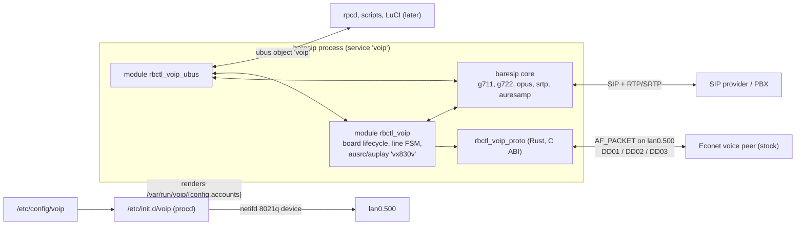

# Plan: FOSS VoIP for the VX830v master (OpenWrt, baresip)

Status: **rev. 3 — decisions closed, ready for confirmation.**

Replaces the whole AArch64 master VoIP stack (`voip_server_proxy`,
`voip_client`, `pjsua`, `cos` glue, `voip.ko`) with free software on OpenWrt.
The Econet (MIPS) voice firmware stays stock and is the compatibility target.

Older plans in this directory (`rbctl-*`, `protobuf.md`, …) target the xDSL
path only. `protobuf.md` §"EtherType safety" is stale for VoIP (two
EtherTypes listed, `voip_client` said to use `0x88B6`); this plan supersedes it
for voice.

---

## 1. Decisions

| # | Decision |
|---|---|
| D1 | Nothing OEM remains on the master; full FOSS stack. |
| D2 | OpenWrt target; configuration via UCI, control/status via ubus, service via procd. |
| D3 | baresip/libre (OpenWrt telephony feed, 3.16.0) as SIP and media engine; our code = protocol library + baresip modules + CLI tool. |
| D4 | Econet voice firmware stays stock; its host-facing contract is fixed. |
| D5 | Fixed G.711 board leg, baresip transcodes for the network leg (§6). |
| D6 | VoIP package licence **GPL-2.0-or-later** (§11). |
| D7 | New codebase; `rbctl-agent` (Econet/xDSL) is not reused. |
| D8 | No master-side OEM capture; validation per §9. |
| D9 | v1 feature set in §7. |

## 2. Goals and non-goals

| ID | Goal | Measured by |
|---|---|---|
| G1 | Interoperate with the stock Econet voice peer over VLAN 500 (`DD01/DD02/DD03`). | M1, M2 tests |
| G2 | Two FXS lines usable as SIP phones: register, call in/out, DTMF, caller ID, tones. | M3, M4 tests |
| G3 | Standard OpenWrt integration: UCI, ubus, procd, opkg package. | M5 tests |
| G4 | Robust unattended operation: recovers from peer reboot, link loss, provider outage. | M6 tests |
| G5 | Every protocol decision traceable to a document in `docs/voip/` or to a recorded test. | Doc map (§3), review at each milestone |

Non-goals for v1: media offload (board RTP directly to provider), T.38,
conference, transfer/forward/DND, LuCI app, IPv6 media, replacing Econet firmware.

## 3. Documentation map

### 3.1 Existing documents and where they are used

| Document | What it provides | Used by |
|---|---|---|
| [docs/voip/index.md](../docs/voip/index.md) | Entry point, audit scope | all |
| [docs/voip/architecture.md](../docs/voip/architecture.md) | OEM process model, startup chain (`rcS` → `cos` → proxy/client), `/dev/voip` ioctls, VLAN `lan0.500` | §5 architecture, M5 init script, risk R5 |
| [docs/voip/board-link.md](../docs/voip/board-link.md) | **Wire contract**: envelope, CRC-16/ARC + vectors, transactions `1a/1b/1c/16/18/19`, retries, MAC learning, DD02 dedupe/ACK, boot dependencies, DSP command inventory, command 10/11 field table, DD03 media body, IPv6 family byte-order bug | M1 library spec, M2 bring-up, M3 media |
| [docs/voip/master-proxy.md](../docs/voip/master-proxy.md) | Raw socket setup, BPF filter, frame offsets, relay behaviour | M1 transport, M3 DD03 handling |
| [docs/voip/controller-startup.md](../docs/voip/controller-startup.md) | Init order (SLIC_LOCALE → DSP_DEFAULT → DSP_START → CHANNEL_DEFAULT), slot affinity, CHANNEL_OPEN body, dial tone/first digit, restart guard | M2 board lifecycle, M3/M4 line FSM |
| [docs/voip/dtmf.md](../docs/voip/dtmf.md) | Digit events 20/24/71 (ASCII values), local vs network DTMF, SIP INFO format | M3 DTMF, M4 digit collection |
| [docs/voip/worker-transcript.md](../docs/voip/worker-transcript.md) | Reference two-line exchange (init, attach, ring, answer, media, update, release), IPv4 RTCP loop quirk, update-destination limitation | M1 differential tests, M2/M3 scenario order |
| [docs/voip/cmsip.md](../docs/voip/cmsip.md) | OEM SIP↔controller IPC | Background only (CMSIP not reimplemented, D1) |
| [docs/voip/replacement.md](../docs/voip/replacement.md) | Earlier boundary analysis and validation milestones | Superseded by this plan; keep scenario list for M4 |
| [docs/voip/map.md](../docs/voip/map.md) | Binary identities and Ghidra addresses | Traceability of every finding |
| [docs/checksum.md](../docs/checksum.md), [examples/checksum.py](../examples/checksum.py) | CRC-16/ARC reference | M1 |
| [vx830v/host_board/docs/backdoor.md](../vx830v/host_board/docs/backdoor.md) | `tcconsole` L2 console on Econet | M2+ peer-side diagnostics |

### 3.2 Existing test assets

| Asset | Purpose | Milestone |
|---|---|---|
| `examples/voip_qemu/run.py` (+ `probe.c`) | OEM routine vectors: client records, proxy framing, DD02 dedupe, DD03 frame | M0 baseline, M1 oracle |
| `examples/voip_qemu/workers.py` (+ `worker_io.c`) | Full OEM proxy worker transcript, two lines | M0 baseline, M1 oracle |
| `examples/voip_qemu/controller.py` (+ `controller.c`) | OEM controller startup, off-hook, dial tone, first digit, CMSIP/media serializers | M0 baseline, M2/M3 expected sequences |
| `examples/voip_qemu/dtmf.py` (+ `dtmf.c`) | DTMF event encoding, 72 assertions | M0 baseline, M3 |
| `examples/voip_trace.py` | Offline pcap decoder for DD01/02/03 (metadata, CRC check) | M2–M6 capture checks |

### 3.3 Documents to create

| Document | Content | Created in |
|---|---|---|
| `docs/voip/peer.md` | Econet peer contract: reply statuses, `1a/1b/1c`, event generation, tone/DTMF/CID tables, `RTP_ACTIVE` field use, codec/ptime limits, 16 kHz path, behaviour on master restart; with Econet addresses | M0 |
| `docs/voip/foss-design.md` | As-built design of library, modules, UCI and ubus API | M1, updated each milestone |
| `docs/voip/test-report.md` | Results per milestone test ID, captures index (private captures referenced, not committed) | M0 onwards |
| Update `plans/protobuf.md` | Correct VoIP EtherType section | M0 |

## 4. Evidence on the peer (basis for M0)

| Evidence | Location | Consequence |
|---|---|---|
| `voip_client_proxy` (MIPS32 BE): `eth0.1.500`, `/var/tmp/sock_CM_DSP`, `rtp-upstream-relay`/`rtp-downstream-relay`, `DD01/02/03` | `vx830v/xDSL/econet_rootfs/userfs/bin/` | Board-side counterpart of the master proxy; analyse statically. |
| `voip_server` + `libadam.so`: `mtkDSPStart`, `mtkChannelOpen`, `mtkRTPActive/Update/Deactive`, `mtkRingStart`, `mtkTonePlay`, `adamChanPlayType2Cid`, `voip_convertTone`, `voip_convertDtmf`, `MTKPTimeConvert` | same, `lib/libadam.so` | Command → DSP API, tone/DTMF/CID tables, ptime limits. |
| `ovdsp.ko`: G.711/G.722/G.726/G.729/iLBC, T.38; `fxs3.ko`: LEC, fax-tone detection; `slic3.ko`, `pcm*.ko`, `DSPCore.ko` | `econet_rootfs/lib/modules/` | DSP capabilities; echo cancellation on the peer. |

## 5. Architecture

### 5.1 Runtime



- One process: board link, line state, SIP and media share the libre event loop.
- Service restart repeats the board `1a` init (same as the OEM proxy at start).
- Signal path: DD02 event → `vx830v` line FSM → baresip UA API (`ua_connect`, `ua_answer`, `call_hangup`, `call_send_digit`) and back via UA events → DSP commands over DD01.
- Media path: DD03 RTP (board leg, G.711) ↔ `rbctl_voip` audio device (8 kHz S16) ↔ baresip audio pipeline ↔ network codec RTP.

### 5.2 Components

| Component | Responsibility | Spec source |
|---|---|---|
| `rbctl_voip_proto` + `rbctl_voip_ffi` + `rbctl_voip_net` (Rust, C ABI) | Envelope, CRC, DD01 engine (seq, retries, MAC learning, subtype/seq matching), DD02 receiver (dedupe, cached ACK, status 1 for short), DD03 framing, DSP record codecs, `AF_PACKET` transport, fake transport for tests | board-link.md, master-proxy.md, peer.md |
| `rbctl_voip` baresip module | Board lifecycle with timeouts; slot allocator (4 slots, affinity `slot & 1`); per-line FSM (idle, dialtone, digits, outgoing, ringing, connected, flash, released); tones, CID, ring; audio device with jitter buffer | controller-startup.md, dtmf.md, peer.md |
| `rbctl_voip_ubus` baresip module | ubus object `voip` (`status`, `lines`, `calls`, `dial`, `hangup`, `reload`), events `voip.board`, `voip.line`, `voip.call`, `voip.reg`; libubus fd in the libre loop | §8.3 |
| `rbctl-voicectl` (Rust) | Bring-up/diagnostic CLI: `init`, `events`, `monitor`, `keypad`, `ring` (with CID), `tone`, `loop` | M2.1 |
| Package `rbctl-voip` | Init script, UCI defaults, rpcd ACL, firewall include | §8 |

### 5.3 Source layout

Target layout from M2.1 (Cargo workspace inside the rbctl feed, next to `rbctl-dsl`):

```
rbctl-feed/rbctl-voip/
  Makefile                      OpenWrt package (rust-package.mk; DEPENDS: baresip, libubus, libubox)
  Cargo.toml, Cargo.lock        workspace (pattern from rbctl-dsl)
  crates/rbctl_voip_proto/      protocol library (sans-I/O)
  crates/rbctl_voip_net/        AF_PACKET sockets over af_packet
  crates/rbctl_voip_ffi/        C ABI staticlib + include/rbctl_voip.h (cbindgen)
  crates/rbctl_voicectl/        bring-up/diagnostic CLI (binary rbctl-voicectl)
  modules/rbctl_voip/           baresip module (C shim over rbctl_voip_ffi), M3
  modules/rbctl_voip_ubus/      baresip ubus control module, M5
  tests/vectors/                golden vectors (from the C prototype and OEM oracle)
  tests/qemu/                   differential tests against examples/voip_qemu oracles
  tests/ffi/                    C smoke test against the generated header
  tests/live/                   scenario scripts for hardware
  files/                        voip.init, voip.config, acl.d/voip.json, firewall include
```

The four crates, recipe and vector/QEMU/FFI tests are present at M2.1 exit. The C/CMake feed was retired after T2.17. `tests/vectors/c_prototype.txt` is the frozen reference; normal builds do not run its historical C generator. Modules and service packaging are later milestones.

## 6. Codec evaluation

Two legs: `phone ─ SLIC/DSP (Econet) ═ DD03 board leg ═ baresip ─ network leg ─ provider`.

- **Network leg: multiple codecs needed** (PCMA, PCMU, G.722; Opus optional). Provided by stock baresip modules, selected per account. Transcoding 2 calls on aarch64 is negligible.
- **Board leg: G.711 sufficient for v1** (PCMA default, PCMU option). Native DSP format; analog handsets are narrowband.

| Board codec | Verdict |
|---|---|
| G.711 | v1 default. |
| G.722 | Only useful if the Econet PCM/SLIC path runs at 16 kHz (`wideBandDet`, `ACODEC_Init_G722` hints). Evaluated in M4. |
| G.726/G.729/iLBC | No benefit on a local link. |
| T.38 | Not in baresip; fax as G.711 passthrough in v1. |

A multi-codec board leg is only required for media offload (deferred).
Echo cancellation stays on the DSP; baresip AEC not loaded; `auresamp` handles 16/48 kHz network codecs.

## 7. v1 feature set

| v1 | Later |
|---|---|
| 2 FXS lines, line↔account mapping, ≤4 accounts | more accounts |
| Registration UDP/TCP/TLS, outbound proxy, digest auth | WebSocket |
| In/out calls, hangup both ends, busy/ringback/congestion tones | conference |
| DTMF: RFC 4733, SIP INFO, in-band fallback | |
| Caller ID (name, number, date) | call-waiting CID |
| Digit map per line, `#` and inter-digit timeout | feature codes |
| Call waiting + hook flash | transfer, forward, DND, MWI |
| SRTP (SDES) | DTLS-SRTP, ICE |
| ubus, UCI, procd | LuCI, call log |
| IPv4 | IPv6 |

## 8. Configuration and API

### 8.1 UCI `/etc/config/voip`

```
config board 'board'
	option enabled '1'
	option device 'lan0'
	option vid '500'
	option locale '0'             # SLIC_LOCALE enum 0..20 (map in peer.md)
	option board_codec 'pcma'     # pcma | pcmu (g722 after M4)
	option ptime '20'
	option init_timeout '120'
	option log_level 'info'

config account 'acc1'
	option enabled '1'
	option user '0123456789'
	option auth_user ''
	option password 'secret'
	option domain 'sip.example.net'
	option registrar ''
	option outbound ''
	option transport 'udp'        # udp | tcp | tls
	option expires '3600'
	list codec 'PCMA'
	list codec 'PCMU'
	list codec 'G722'
	option dtmf 'rfc4733'         # rfc4733 | info | inband
	option srtp 'off'             # off | optional | mandatory
	option display_name ''

config line 'line0'
	option enabled '1'
	option port '0'
	option account 'acc1'
	option digitmap '[0-9*#]+'
	option interdigit_timeout '4'
	option cid '1'
	option call_waiting '1'
	option flash_min_ms '100'
	option flash_max_ms '800'

config line 'line1'
	option enabled '1'
	option port '1'
	option account 'acc1'
	option digitmap '[0-9*#]+'
	option interdigit_timeout '4'
	option cid '1'
	option call_waiting '1'
```

### 8.2 Rendering

| UCI | Target |
|---|---|
| `board.device`, `board.vid` | netifd `config device` (type `8021q`, `<device>.<vid>`); module binds there |
| `board.*` | baresip `config`: `rbctl_voip_device`, `rbctl_voip_locale`, `rbctl_voip_codec`, `rbctl_voip_ptime`, `rbctl_voip_init_timeout` |
| `account` | baresip `accounts`: `<sip:user@domain>;auth_user=;auth_pass=;outbound=;audio_codecs=;mediaenc=srtp*;dtmfmode=;regint=` |
| `line` | `rbctl_voip_line <port>,<aor>,<digitmap>,<timeout>,<cid>,<cw>,<flash_min>,<flash_max>` |

procd: instance `baresip -f /var/run/voip`, respawn, `/var/run/voip` mode 0700; `service_triggers` on `voip` (restart for `board`, ubus `voip reload` for accounts/lines); firewall include for SIP/RTP when enabled.

### 8.3 ubus `voip`

| Method / event | Content |
|---|---|
| `status` | board state (`down/init/ready/error`), peer MAC, per-account registration, per-line state |
| `lines`, `calls` | line FSM state, slot, call id, peer URI, codec, duration |
| `dial {line, uri}`, `hangup {line}` | test/automation hooks |
| `reload` | re-read accounts/lines without board re-init |
| `voip.board`, `voip.line`, `voip.call`, `voip.reg` | state change events |

## 9. Milestones and completion tests

Each milestone is complete only when **all** its tests pass and results are
recorded in `docs/voip/test-report.md` (test ID, date, commit, pass/fail,
capture reference). Live tests use a LAN test PBX (e.g. Asterisk) and two
analog phones.

### M0 — Evidence baseline

Goal: close peer unknowns; confirm OEM oracles still run.
Docs: board-link.md, master-proxy.md, worker-transcript.md, controller-startup.md, dtmf.md → produce peer.md.

| Test | Command / method | Pass criteria |
|---|---|---|
| T0.1 | `python3 -B examples/voip_qemu/run.py` | exit 0, all byte comparisons pass |
| T0.2 | `python3 -B examples/voip_qemu/workers.py` | exit 0; 17 DD01 transactions, 1 retransmit, 8 DD02 events as documented |
| T0.3 | `python3 -B examples/voip_qemu/controller.py` | exit 0 |
| T0.4 | `python3 -B examples/voip_qemu/dtmf.py` | exit 0, 72 event assertions + 24 INFO writes |
| T0.5 | Review of `docs/voip/peer.md` | every item in §3.3 answered with Econet address, or marked unknown with a live test assigned in M2 |
| T0.6 | `plans/protobuf.md` VoIP section corrected | reviewed |

### M1 — Protocol library

Goal: `libvx830v-voice` byte-exact with the OEM host.
Docs: board-link.md (envelope, transactions, inventory, field tables), master-proxy.md, peer.md.

| Test | Command / method | Pass criteria |
|---|---|---|
| T1.1 | `make -C tests/unit check` | CRC vectors `277e`, `591f`, `bb3d`; header encode/decode round-trip |
| T1.2 | unit: DD01 engine with fake transport | seq increments per new request; retransmit identical frame; 1000 ms×120 / 300 ms×2 limits; reply matched on subtype+seq; failures returned |
| T1.3 | unit: DD02 receiver | duplicate seq → identical cached ACK, single delivery; short body → status 1; queue full → non-zero status |
| T1.4 | unit: DSP encoders | for each command in board-link.md inventory: length and BE layout; family field `htonl` |
| T1.5 | `tests/qemu/diff.py` | our encoders vs OEM serializers from `examples/voip_qemu` for identical inputs: byte-identical records and frames (ring/stop-ring, channel default, CHANNEL_OPEN, RTP_ACTIVE/DEACTIVE, DD03 frame) |
| T1.6 | ASan/UBSan unit run + fuzz decoders 10 min | no findings |

### M1.1 — Library polish (post-M1, before M2)

Goal: make `libvx830v-voice` maintainable and ready to be consumed by the
baresip modules and `voicectl`, **without changing wire behaviour** except for
the listed review fixes. Every T1.x test must still pass afterwards.
Docs: [foss-design.md](../docs/voip/foss-design.md), M1 review notes (§13.5).

Deliverables:

1. **API documentation.**
   - Split `voice.h` into topic headers with an umbrella include: `vx/wire.h` (frame, CRC, media prefix), `vx/dsp.h` (DSP records), `vx/link.h` (transaction engine), `vx/packet.h` (AF_PACKET transport); `vx/voice.h` includes all four.
   - Plain inline comments written for a developer reading the code (no doc generator required). On every public function, struct, struct member, enum and constant: what it is for, each argument (direction in/out, units, byte order, valid range), return values and `-errno` codes, buffer ownership/lifetime (borrowed views), threading and re-entrancy rules, and which document section defines the field (board-link.md / peer.md anchor).
   - Implementation files (`.c`) get short comments at each non-obvious step: why a check exists, which OEM/peer behaviour it mirrors or deliberately differs from, and protocol constants explained where they are used (retry budgets, 60-byte padding, marker values, 15-entry FIFO, CRC coverage).
   - Comments explain intent and protocol meaning, not restate the code line by line.
   - `struct vx_media_cfg`, `struct vx_dsp` union arms and `struct vx_link` state fields: one comment per member naming its wire offset and meaning; private state of `vx_link` marked as such.
   - Short usage example in `vx/link.h` (event-loop integration) matching foss-design.md.
2. **Formatter and linters (Linux kernel C style).**
   - `.clang-format`: Linux style (tabs, 8-column indent, 80-column limit, `BreakBeforeBraces: Linux`, pointer `*` attached to the name), written for this project.
   - `checkpatch.pl --no-tree --strict --file` from a Linux source tree as an external tool (not vendored); SPDX line form per kernel rules (`//` in `.c`, `/* */` in `.h`).
   - `clang-tidy` with a checked-in `.clang-tidy` (`bugprone-*`, `cert-*`, `clang-analyzer-*`, `misc-*`, selected `readability-*`; documented exclusions), plus `cppcheck --enable=warning,portability,performance`.
   - Reformat the existing sources once in a separate commit (format-only), so later diffs stay reviewable.
3. **CMake build** replacing the hand-written Makefiles in `src/lib` and `tests/unit`.
   - Top-level `CMakeLists.txt` (CMake ≥ 3.16): library target `vx830v-voice` (static and shared, `SOVERSION`), installed public headers under `include/vx/`, generated `vx830v-voice.pc` for pkg-config.
   - Options: `VX_BUILD_TESTS`, `VX_SANITIZE` (ASan/UBSan), `VX_FUZZ` (Clang libFuzzer), `VX_BUILD_TOOLS`, `VX_BUILD_MODULES` (off until M3; will find baresip/libre via pkg-config).
   - CTest: unit tests, sanitizer variant, `qemu_diff` (skipped with a clear message if `qemu-aarch64`/OEM rootfs are missing).
   - Custom targets: `format` (apply), `format-check`, `checkpatch`, `tidy`, `cppcheck`, `lint` (all checks).
   - OpenWrt package `Makefile` switched to `include $(INCLUDE_DIR)/cmake.mk`, as the telephony feed already does for baresip.
4. **Review fixes from the M1 review** (behavioural; each with a unit test):
   - `1c` no longer blocks the link: rejected by `vx_request`, or allowed only with an explicit caller-supplied retry budget.
   - Initial DD01 sequence is caller-seedable (random seed recommended) instead of always starting at 1.
   - Decide and document whether failure ACKs (status 1/2) are cached; if not cached, a peer retry after the FIFO drains is accepted.
   - Ignore our own transmitted frames at the socket (`PACKET_OUTGOING`) in `vx_packet_read`.
   - `docs/voip/index.md` links `peer.md`, `foss-design.md`, `test-report.md`; scratchpad §13.2 tidied (diagnostic rows grouped under the final T0.3 result).

| Test | Command / method | Pass criteria |
|---|---|---|
| T1.7 | `cmake -S . -B build -DVX_BUILD_TESTS=ON && cmake --build build && ctest --test-dir build --output-on-failure` | builds with `-Wall -Wextra -Werror`; all tests pass (T1.1–T1.5 equivalents) |
| T1.8 | `cmake -B build-san -DVX_SANITIZE=ON -DVX_BUILD_TESTS=ON` + `ctest` | pass, no sanitizer report |
| T1.9 | `cmake --build build --target lint` | `format-check` clean; checkpatch 0 errors / 0 warnings (any accepted exception listed in `docs/voip/foss-design.md`); clang-tidy and cppcheck 0 findings |
| T1.10 | Documentation review of `include/vx/*.h` and `src/lib/*.c` against a checklist in `docs/voip/test-report.md` | every public symbol, argument and struct member has an inline comment covering purpose, units/byte order, ownership and errors; each non-obvious step in the `.c` files explains why; a reviewer unfamiliar with the code can map each wire field to its doc section from the comments alone |
| T1.11 | Review fixes unit tests | `1c` behaviour, seeded sequence, ACK-cache policy, outgoing-frame filter covered and passing |
| T1.12 | Regression: `python3 -B tests/qemu/diff.py` and 10 min fuzz via `-DVX_FUZZ=ON` | unchanged T1.5 result (19 comparisons, 2528 bytes); no fuzz findings |
| T1.13 | Packaging smoke: OpenWrt SDK `make package/vx830v-voip/compile` (aarch64), if the SDK is available; otherwise record as deferred to T5.1 | library and headers staged, `.pc` file installed |

Exit: T1.7–T1.12 pass (T1.13 pass or explicitly deferred), Makefiles removed,
foss-design.md updated for the CMake commands and header layout.

### M2 — Board bring-up on hardware

Goal: our code drives the real peer without baresip.
Docs: board-link.md §boot dependencies, controller-startup.md §DSP initialization, peer.md.

| Test | Command / method | Pass criteria |
|---|---|---|
| T2.1 | `vx830v-voicectl init` | `1a` reply status 0, then SLIC event 1 and DSP event 2 received; CHANNEL_DEFAULT ×4 sent; ≤ 5 s |
| T2.2 | `vx830v-voicectl events` + lift/replace handset on each line | HOOK_OFF/HOOK_ON with correct line 0/1 |
| T2.3 | press `0-9*#` on each line | DTMF_START/END with ASCII digits per dtmf.md |
| T2.4 | `vx830v-voicectl ring --line N --cid name,number` | phone rings, CID displayed; `RING_STOP` stops it |
| T2.5 | `vx830v-voicectl tone --line N --sel 4` / `--sel 0` | dial tone on / off |
| T2.6 | `vx830v-voicectl loop --line 0 --to 1` | two-way audio between the two phones over DD03 |
| T2.7 | `tcpdump -i lan0.500 -w m2.pcap 'ether proto 0xdd01 or 0xdd02 or 0xdd03'` then `python3 examples/voip_trace.py -v m2.pcap` | all frames classified, 0 CRC mismatches |
| T2.8 | restart `voicectl` 10× | peer re-initialises each time (answers T0.5 restart item) |

### M2.1 — Rust port of library and CLI (post-M2, before M3)

Goal: replace the C `libvx830v-voice` and `rbctl-voicectl` with Rust
equivalents that are easier to read and extend, **without changing wire
behaviour**. The library keeps a C ABI so the M3 baresip module can embed it.
Docs: [foss-design.md](../docs/voip/foss-design.md), [board-link.md](../docs/voip/board-link.md),
[peer.md](../docs/voip/peer.md), M2 closure in [test-report.md](../docs/voip/test-report.md#m2-closure).

**Naming (rbctl family):** feed package `rbctl-feed/rbctl-voip` (OpenWrt package `rbctl-voip`), crates `rbctl_voip_proto`, `rbctl_voip_ffi`, `rbctl_voip_net`, `rbctl_voicectl` (binary `rbctl-voicectl`), C header `rbctl_voip.h` with symbol prefix `rbctl_voip_`, baresip modules `rbctl_voip` and `rbctl_voip_ubus`. User-facing names stay generic: UCI config `voip`, ubus object `voip`, procd service `voip`. The M1–M2 C artifacts (`libvx830v-voice`, `vx830v-voicectl`, `voip-feed/vx830v-voip`) keep their historical names until removed at M2.1 exit.

**Reuse from `rbctl-feed/rbctl-dsl`** (same toolchain, conventions and OpenWrt recipe):

| Item | Reuse | Note |
|---|---|---|
| Workspace layout, `[workspace.dependencies]`, release profile (`opt-level="z"`, LTO, `codegen-units=1`, `panic="abort"`, strip) | Copy pattern | Same `rust-version` floor (1.80). |
| `crc` crate (`CRC_16_ARC`), as in `rbctl_proto::checksum` | Direct dependency | MIT/Apache-2.0. Do **not** depend on `rbctl_proto` itself (0x88B5-specific). |
| `af_packet` crate (`RawSocket::open(iface, ethertype)`, `recv` with `pkt_type`) | Path dependency, one socket per EtherType (DD01/DD02/DD03) | **Licence blocker below.** Fix its `pkt_type` doc comment (Linux: HOST=0, BROADCAST=1, MULTICAST=2, OTHERHOST=3, OUTGOING=4) and filter `PACKET_OUTGOING`. |
| `clap` (derive), `log`, `nanologger`, `libc` | CLI and logging | Same versions/features as rbctl-dsl. |
| OpenWrt `rust-package.mk`, `PKG_BUILD_DEPENDS:=rust/host`, `RUST_PKG_LOCKED:=1`, workspace-copying `Build/Prepare` | Packaging | `ubus-zero`/`rust-uci` not needed in M2.1; candidates for M5. |

**Licence constraint (D6, §11):** the VoIP library is loaded into baresip,
which links OpenSSL 3 (Apache-2.0), so every crate it links must be compatible
with GPL-2.0-or-later/GPLv3. `af_packet` is currently **GPL-2.0-only**
(rbctl workspace licence). Before reuse, relicense `af_packet` as
`GPL-2.0-or-later` (same authors; still usable by GPL-2.0-only rbctl-dsl), or
move it to a shared crate under that licence. `rbctl_proto` is not reused.

**Workspace** `rbctl-feed/rbctl-voip/` (replaces the CMake C tree once parity is proven):

| Crate | Kind | Responsibility |
|---|---|---|
| `rbctl_voip_proto` | `rlib` | Pure protocol, sans-I/O: envelope/CRC, DSP record encode/decode (typed enums/structs per command), DD01 request engine, DD02 receiver/ACK cache/FIFO, DD03 framing. No `unsafe`, no allocation in hot paths, no panics on any input (`clippy::unwrap_used`, `expect_used`, `panic`, `indexing_slicing` denied). Time passed in by caller. |
| `rbctl_voip_ffi` | `staticlib` (+ `cdylib` for tests) | Stable C ABI for the baresip module: opaque `rbctl_voip_link` handle, send callback, `-errno` returns, borrowed views, no panic across FFI. Header `include/rbctl_voip.h` generated by `cbindgen` and committed; CI fails if regenerated header differs. |
| `rbctl_voip_net` | `rlib` | Thin wrapper over `af_packet`: three sockets on the VLAN device, nonblocking fds for an external event loop, drops `PACKET_OUTGOING`. |
| `rbctl_voicectl` (binary `rbctl-voicectl`) | `bin` | Port of every M2 subcommand (`init`, `events`, `monitor`, `keypad`, `ring`, `tone`, `loop`) and the warm-attach behaviour (skip DSP_START when attach reports running, reclaim slots). Test-only media profile override as a CLI flag, not link-time wrapping. |
| `xtask` (optional) | `bin` | `cargo xtask lint/vectors/oracle` helpers. |

Documentation: rustdoc (`///`) on every public item with the same content
required in M1.1 (purpose, units, byte order, ranges, errors, ownership,
doc-section link); module-level `//!` overview per protocol area;
`#![deny(missing_docs)]` on `rbctl_voip_proto` and `rbctl_voip_ffi`.

Deliverables:

1. Rust crates above, with `cargo fmt`, `cargo clippy -- -D warnings`, `cargo deny check licenses` (allow list: MIT, Apache-2.0, BSD-*, ISC, Unicode, GPL-2.0-or-later; deny GPL-2.0-only in the library graph).
2. **Golden vectors**: before removing C, generate `tests/vectors/*.bin|json` from the C library and OEM oracle for every DSP command, frame type, ACK/dedupe sequence and media frame; Rust must reproduce them byte-for-byte.
3. Ported unit tests (`cargo test`), property tests with `proptest` (dev-dependency) for encode/decode round-trips and decoder robustness, `cargo fuzz` targets for frame and record decoders.
4. QEMU differential (`tests/qemu/diff.py`) driven by a Rust vector binary.
5. FFI test: a small C program linked against `librbctl_voip_ffi.a` using only the generated header (proves the M3 embedding path), built under ASan/UBSan.
6. OpenWrt package recipe using `rust-package.mk`; packages `rbctl-voicectl` (bin) and staged `librbctl_voip_ffi.a` + header for the M3 module build.
7. Remove the C library/CLI and CMake files after T2.1x hardware parity; update `foss-design.md` (as-built Rust API) and §5.3 layout.
8. M2 carry-over: T2.5 dial tone on PHONE2 (line 1).

| Test | Command / method | Pass criteria |
|---|---|---|
| T2.10 | `cargo build --workspace --locked && cargo test --workspace` | all pass on host |
| T2.11 | `cargo fmt --check`, `cargo clippy --workspace --all-targets -- -D warnings`, `cargo deny check` | no findings; library dependency graph contains no GPL-2.0-only or Apache-only-incompatible item |
| T2.12 | Golden vectors | Rust output byte-identical to C/OEM vectors for all records, frames, ACK/dedupe and media cases (incl. CRC `277e`, `591f`, `bb3d`) |
| T2.13 | `python3 -B tests/qemu/diff.py` with the Rust vector binary | 19 comparisons / 2528 bytes, as T1.5 |
| T2.14 | `cargo +nightly fuzz run` frame and record targets, 10 min each; proptest suites | no crash, panic or sanitizer report |
| T2.15 | FFI smoke: C test against generated header + staticlib, ASan/UBSan | pass; header up to date (`cbindgen` diff empty) |
| T2.16 | Cross-build `aarch64-unknown-linux-musl` via OpenWrt rust toolchain (`make package/rbctl-voip/compile`, or the configured tree as in T1.13) | `rbctl-voicectl` static/stripped binary and `librbctl_voip_ffi.a` produced; size recorded |
| T2.17 | Hardware parity with Rust `rbctl-voicectl`: T2.1, T2.2, T2.3, T2.5 (**both lines**), T2.6 (direction 3 profile), T2.7 capture + `voip_trace.py`, T2.8 (3 warm restarts incl. one with active slots) | same pass criteria as M2; results recorded in test-report.md |
| T2.18 | Rustdoc review | `cargo doc --no-deps` warning-free with `missing_docs` denied; checklist as T1.10 |

Exit: T2.10–T2.18 pass, C sources removed, §5.2/§5.3 updated, licence
of every linked crate recorded in foss-design.md. M3 starts from the Rust
library via `rbctl_voip_ffi`.

### M3 — Single call through baresip

Goal: one line, one account, full call.
Docs: controller-startup.md (off-hook → first digit), dtmf.md, board-link.md §media.

| Test | Command / method | Pass criteria |
|---|---|---|
| T3.1 | start baresip with `rbctl_voip` module, account on test PBX | registered; `rbctl_voip` reports board ready |
| T3.2 | outgoing: off-hook, dial tone, dial extension, `#` | INVITE to the right URI; ringback; answer → two-way audio |
| T3.3 | incoming from PBX | phone rings with CID; off-hook answers; two-way audio |
| T3.4 | hangup from phone and from PBX (each) | BYE sent/received; slot freed (RTP_DEACTIVE + CHANNEL_CLOSE); line idle |
| T3.5 | DTMF in call, account `rfc4733` and `info` | PBX receives correct digits (Asterisk DTMF log) |
| T3.6 | audio quality | mouth-to-ear latency ≤ 150 ms added by master (loopback measurement); no audible echo |
| T3.7 | 30 calls back-to-back | no leaked slots/sockets/memory (ubus `status`, `/proc` RSS stable) |

### M4 — Two lines and v1 features

Goal: §7 feature set on both lines.
Docs: replacement.md scenario list, controller-startup.md (slot affinity), dtmf.md.

| Test | Command / method | Pass criteria |
|---|---|---|
| T4.1 | T3.2–T3.5 on line 1 | pass |
| T4.2 | simultaneous calls on both lines | both two-way, independent hangup, slots per affinity |
| T4.3 | call waiting + flash | second call signalled; flash swaps; hangup of either works |
| T4.4 | busy, unreachable, congestion | correct tone per case |
| T4.5 | digit map / inter-digit timeout | dial triggers on match, `#`, or timeout |
| T4.6 | SRTP `mandatory` against PBX | encrypted media, call succeeds |
| T4.7 | G.722 network codec | wideband negotiated to PBX; board leg stays G.711 |
| T4.8 | G.722 board-leg evaluation | report in test-report.md: supported/not, measured benefit; decision recorded |

### M5 — OpenWrt integration

Goal: installable package configured by UCI, controlled by ubus.
Docs: architecture.md (startup chain replaced), this plan §8.

| Test | Command / method | Pass criteria |
|---|---|---|
| T5.1 | build in OpenWrt SDK, `opkg install rbctl-voip` on a clean image | installs, service enabled, no OEM files needed |
| T5.2 | edit UCI account, `uci commit voip` | `reload` applied without board re-init; new registration |
| T5.3 | edit `board.locale`, commit | service restart, board re-init |
| T5.4 | `ubus call voip status`, `ubus listen voip.*` during a call | JSON matches §8.3; events in order |
| T5.5 | `ubus call voip dial '{"line":0,"uri":"sip:100@pbx"}'` / `hangup` | call placed/ended |
| T5.6 | reboot | service up, registered, lines ready without manual steps |
| T5.7 | rpcd ACL | unauthenticated ubus-over-HTTP cannot call `dial` |

### M6 — Hardening

Goal: unattended operation (G4).
Docs: board-link.md §boot dependencies (OEM failure modes to avoid), worker-transcript.md §recovery.

| Test | Command / method | Pass criteria |
|---|---|---|
| T6.1 | power-cycle Econet board while idle | `voip.board` down → ready; lines usable again ≤ 60 s |
| T6.2 | power-cycle Econet board during a call | call ended cleanly; recovery as T6.1 |
| T6.3 | unplug/replug VLAN link | as T6.1 |
| T6.4 | kill baresip (`kill -9`) | procd respawn; board re-init; registered |
| T6.5 | provider unreachable 10 min | re-registration after recovery; lines give congestion tone meanwhile |
| T6.6 | 24 h soak with scripted calls every 5 min on both lines | 0 failures; RSS growth < 5 % |
| T6.7 | malformed/fuzzed DD02/DD03 frames injected from a test host | no crash; counters increment |

## 10. Test environments

| Environment | Used in |
|---|---|
| Host (x86_64) unit tests, sanitizers, fuzzers | M1 |
| QEMU user-mode with OEM AArch64 binaries (`examples/voip_qemu`) | M0, M1 |
| Python peer emulator (`tests/peer-emu`) on a veth pair | M1–M5 CI |
| OpenWrt on the VX830v master + stock Econet board + 2 analog phones + LAN PBX | M2–M6 |
| Optional private reference: OEM `voip_server_proxy` run on OpenWrt against the real peer, captured with tcpdump; never distributed | M2 if T0.5 leaves gaps |
| Econet `tcconsole` diagnostics (`vx830v/host_board/docs/backdoor.md`) | M2–M6 debugging |

## 11. Licensing

- `rbctl-voip` (library, modules, CLI, scripts): **GPL-2.0-or-later**; SPDX header `GPL-2.0-or-later` in every source file, `LICENSE` = GPLv2 text with the "or later" notice.
- Rationale: libre links OpenSSL 3.x (Apache-2.0); Apache-2.0 is GPLv3-compatible, so the "or later" grant allows the combined process to be distributed under GPLv3. baresip/libre are BSD-3 (compatible).
- `rbctl-*` crates remain GPL-2.0-only. Exception from M2.1: the shared `af_packet` crate must be relicensed GPL-2.0-or-later before the VoIP library links it; `cargo deny` enforces the allow list.
- No OEM code or binaries are included in the package or tests committed to the repo; OEM binaries are used only locally as test oracles.

## 12. Risks

| ID | Risk | Mitigation | Closed by |
|---|---|---|---|
| R1 | Peer addresses RTP via `RTP_ACTIVE` IPs/ports | M0 RE; choose values keeping media on DD03 | T0.5, T2.6 |
| R2 | Board-leg latency/jitter | DSP LEC; small jitter buffer | T3.6 |
| R3 | Peer rejects re-init after master restart | M0 RE; restart tests | T2.8, T6.4 |
| R4 | Locale → electrical profile mapping | `locale` in UCI; per-country ring/CID check | T2.4 |
| R5 | `/dev/voip` ioctls (`0x403476xx`) provided RTP QoS/conntrack | nftables/QoS rules if needed | T3.6, T6.6 |
| R6 | baresip API changes between versions | pin feed version 3.16.0; module CI against it | T5.1 |
| R7 | Legal | docs ↔ implementation separation; §11 | review |

---

## 13. Scratchpad (living section — update during development)

Rules: newest entry first; one entry per work session; reference test IDs
(§9), commits and documents. Do not paste credentials, caller IDs or audio.
Move stable conclusions into `docs/voip/*` and leave a pointer here.

### 13.1 Milestone status

| Milestone | Status | Started | Completed | Commit | Notes |
|---|---|---|---|---|---|
| M0 Evidence | done | 2026-11-25 | 2026-11-25 | Uncommitted | 6/6 pass; [test report](../docs/voip/test-report.md) |
| M1 Library | done | 2026-11-25 | 2026-11-25 | Uncommitted | T1.1–T1.6 pass; [as built](../docs/voip/foss-design.md) |
| M1.1 Library polish | done | 2026-11-25 | 2026-11-25 | Uncommitted | T1.7–T1.12 pass; AArch64 staging verified, standalone SDK deferred. |
| M2 Bring-up | done | 2026-11-25 | 2026-11-25 | Uncommitted | [8/8 passed](../docs/voip/test-report.md#m2-closure); T2.4 caller number displayed. Extended CID tracked separately. |
| M2.1 Rust port | done | 2026-11-25 | 2026-11-25 | `feature/rbctl-voip` (workspace); `becbc9e`, `c96803a`, `0b79262` (af_packet) | [Hardware parity and closure](../docs/voip/test-report.md#m21-closure). C prototype retired; T2.16 accepted with SDK build deferred to T5.1. |
| M3 Single call | not started | | | | |
| M4 Two lines + features | not started | | | | |
| M5 Integration | not started | | | | |
| M6 Hardening | not started | | | | |

Status values: `not started`, `in progress`, `blocked (<reason>)`, `done`.

### 13.2 Test results

All entries below used an **uncommitted working tree**. The base column identifies HEAD at the time, not a commit containing the implementation or test results.

| Test ID | Date | Base revision / tree | Result | Evidence / note |
|---|---|---|---|---|
| T2.18 | 2026-11-25 | `c96803a` + WT | pass | rustdoc warning-free, `missing_docs` denied. |
| T2.17 | 2026-11-25 | Rust CLI `abcc62e2…` | pass | Cold/warm, hooks, keypads, tones, two-way audio, frame validation and owner-death recovery; [live evidence](../docs/voip/test-report.md#m21-closure). |
| T2.16 | 2026-11-25 | `c96803a` + WT | partial | aarch64 musl cross-build via rustup std + OpenWrt GCC linker; 529 KB dynamic binary runs under QEMU. SDK package build deferred to T5.1. |
| T2.15 | 2026-11-25 | `c96803a` + WT | pass | C smoke (ASan/UBSan) against generated header + staticlib; header current. |
| T2.14 | 2026-11-25 | `c96803a` + WT | pass | proptest 4×4096; fuzz frame/record/link/frame_valid 10 min each, 419 M execs total, no findings. |
| T2.13 | 2026-11-25 | `c96803a` + WT | pass | QEMU differential 19/2528 with Rust vector binary. |
| T2.12 | 2026-11-25 | `c96803a` + WT | pass | 163/163 golden vectors from the C prototype. |
| T2.11 | 2026-11-25 | `c96803a` + WT | pass | fmt, clippy (both feature sets, -D warnings), cargo deny licences/bans/sources. |
| T2.10 | 2026-11-25 | `c96803a` + WT | pass | workspace build + all tests incl. 17 CLI scenarios. |
| M2 closure / T2.4 | 2026-11-25 | `5670764` + WT | pass (review) | Existing live number-display/ring/stop evidence meets §9. Name/date not claimed. |
| T2.6 isolation B2 | 2026-11-25 | `5670764` + WT | pass (flow) | Direction 3, relay off, 999 RTP per slot in 20 s; acoustic comparison unclear. |
| T2.6 isolation A2 | 2026-11-25 | `5670764` + WT | expected no RTP | Direction 0, relay off, 0 RTP each way in 5 s; one incidental RTCP. |
| T2.6 isolation B1 | 2026-11-25 | `5670764` + WT | pass (flow) | Direction 3, relay off, 999 RTP per slot in 20 s. |
| T2.6 isolation A1 | 2026-11-25 | `5670764` + WT | expected no RTP | Direction 0, relay off, 0 RTP each way in 5 s. |
| M2 closure regressions | 2026-11-25 | `5670764` + WT | pass | Host CTest 4/4 and ASan/UBSan CTest 4/4. |
| T2.8 live runs 1–10 | 2026-11-25 | `5670764` + WT | pass | Nine idle, tenth after master owner killed with two active slots; 51–58 ms. All ten sequences verified. [Per-run results](../docs/voip/test-report.md). |
| T2.8 stale-media validation | 2026-11-25 | `5670764` + WT | pass | DD03 after owner death, none in post-recovery sample; fresh two-slot loop forwarded 99 RTP each way. Earlier fractional-sleep setup aborted, not a counted run. |
| T2.8 offline preparation | 2026-11-25 | `5670764` + WT | pass | cli_startup: cold vs warm gates and failed slot cleanup; binary hash verified. |
| T2.8 legacy warm baseline | 2026-11-25 | `5670764` + WT | fail | Fresh DSP_START completion absent after matching transport ACK; 5 s timeout. |
| T2.7 live | 2026-11-25 | `5670764` + WT | pass | All 1,232 frames classified/full-length/CRC OK (20 DD01, 2 DD02, 1,210 DD03); no kernel drops. Raw temporary capture deleted. |
| T2.6 live, 45 s | 2026-11-25 | `5670764` + WT | pass | 2250 RTP / 9 RTCP each way; reverse audio confirmed clearly, forward already confirmed. |
| T2.6 live, 12 s | 2026-11-25 | `5670764` + WT | partial | OEM fixture profile: 600 RTP / 3 RTCP each way; PHONE1→2 audible. |
| T2.6 reference preparation | 2026-11-25 | `5670764` + WT | pass | CLI tests passed for reference profile and rejected activation; AArch64 binaries verified. |
| T2.6 diagnostic, 6 s | 2026-11-25 | `5670764` + WT | fail | No forwarded packets; independent counter saw just two inbound DD03 frames around run. |
| T2.6 initial live, 20 s | 2026-11-25 | `5670764` + WT | fail | DD01 succeeded; direction 0 / DTMF disabled profile yielded no forwarded packets or audible audio. |
| T2.6 initial preparation | 2026-11-25 | `5670764` + WT | pass | Offline cross-slot relay and cleanup regression. |
| T2.5 live | 2026-11-25 | `5670764` + WT | pass | Simple PHONE1 off-hook: selector 4 dial tone, selector 0 silence after ~6 s; slot 0 closed three seconds later. |
| T2.5 CLI preparation | 2026-11-25 | `5670764` + WT | pass | Socket-pair CLI test covered command sequence and standalone stop. AArch64 cross-build and deployed hash verified. |
| T2.4 PHONE1 cadence | 2026-11-25 | `5670764` + WT | pass (audible cadence) | Approximate starts at 0/5/10/15/20 s; ends at 1/6/11/16/21 s. No CID or locale commands. |
| Cadence CLI preparation | 2026-11-25 | `5670764` + WT | pass | Host cli_startup passed; extended bounded window and verified AArch64 deployment. |
| T2.4 PHONE2 cadence follow-up | 2026-11-25 | `5670764` + WT | inconclusive timing | No locale change or CID_PLAY. Brief initial alert then normal ring; about 10 s total, no measured inter-burst interval. |
| T2.4 Italy / PHONE2 | 2026-11-25 | `5670764` + WT | partial | DSP_DEFAULT 10 ACK before CID/ring; number displayed, date/time absent, name unconfirmed. Rang/stopped; timing unassessed. PHONE1 stop also confirmed. |
| T2.4 CID preparation | 2026-11-25 | `5670764` + WT | pass | CLI peer fixture checked profile → CID fields → ring/stop, rebuilt and verified AArch64 binary. |
| T2.4 live | 2026-11-25 | `5670764` + WT | partial | PHONE1 audible ring confirmed; start/stop ACKs, no explicit audible-stop confirmation. PHONE2 not rung; CID not sent. |
| T2.4 CLI preparation | 2026-11-25 | `5670764` + WT | pass | Offline CLI suite includes same-line stop even after lost start ACK; AArch64 binary built and verified. |
| T2.2/Q2 live extension | 2026-11-25 | `5670764` + WT | pass | One FLASH press → DD02 command 19 between lift/hangup, first on PHONE2/line 1 then PHONE1/line 0. Not T4.3. |
| Flash monitor preparation | 2026-11-25 | `5670764` + WT | pass | Host `cli_startup` warm monitor regression and AArch64 cross-build. |
| T2.3 live | 2026-11-25 | `5670764` + WT | pass | One handset moved between ports; 12 exact ASCII press/release pairs per line; exit 0. |
| T2.3 CLI preparation | 2026-11-25 | `5670764` + WT | pass | Offline CLI startup suite including mismatched release word; cross-build and remote checksum verified. |
| T2.1 live | 2026-11-25 | `5670764` + WT | pass | Mainline OpenWrt VX830V, locale 0: attach state 1, fresh DSP-start result 0, slots 0–3 acknowledged, ready in 115 ms. No capture. |
| T2.2 live | 2026-11-25 | `5670764` + WT | pass | PHONE1 then PHONE2 physically lifted and replaced; matched OFF/ON pairs on lines 0 then 1. |
| M2 CLI cross-build | 2026-11-25 | `5670764` + WT | pass | Standalone AArch64 ELF, no dynamic section; QEMU `--help` passed. |
| M2 CLI preparation | 2026-11-25 | `5670764` + WT | pass (offline) | Host and sanitized CTest each 4/4; init, hook events, missing completion and peer errors tested. Not T2.1/T2.2. |
| T1.9 tool discovery review | 2026-11-25 | `5670764` + WT | pass | Fresh optional configure and lint reported skips; strict configure with missing tools was rejected as expected. |
| T1.9/T1.10 review | 2026-11-25 | `5670764` + WT | pass | Actual full lint with local explicit tool paths; formatted header declarations and caller-facing comments reviewed. |
| T1.7 review | 2026-11-25 | `5670764` + WT | pass | Rebuilt and ran all three CTest cases. |
| T1.13 | 2026-11-25 | `5670764` + WT | staging pass; SDK deferred | AArch64 OpenWrt package-local compile/stage + sysrooted pkg-config; standalone SDK at T5.1. |
| T1.13 setup | 2026-11-25 | `5670764` + WT | failed attempts | Top-level scanner group collision; inner make lacked target; first package-local invocation lacked staged Ninja on PATH. Host CMake install succeeded separately. |
| T1.12 | 2026-11-25 | `5670764` + WT | pass | Standalone diff 19/2528; Clang libFuzzer 96,953,265 runs in 601 s. |
| T1.11 | 2026-11-25 | `5670764` + WT | pass | Three link review regressions plus outgoing/incoming receive metadata. |
| T1.10 | 2026-11-25 | `5670764` + WT | pass | [API and implementation review checklist](../docs/voip/test-report.md). |
| T1.9 | 2026-11-25 | `5670764` + WT | pass | Final aggregate lint, 14 files checkpatch/format, 8 C sources tidy/cppcheck. Initial passes identified style, nonportable advice, assertion side effects and cppcheck data-path setup; relative header paths fixed external checkpatch on spaced checkout. |
| T1.8 | 2026-11-25 | `5670764` + WT | pass | Initial and final ASan/UBSan build: CTest 3/3. |
| T1.7 | 2026-11-25 | `5670764` + WT | pass | Initial and final host build: CTest 3/3; optional-QEMU skip verified separately. |
| T1.5 review | 2026-11-25 | `5670764` + WT | pass | 19/19 differential comparisons, deterministic replay seed. |
| T1.6 unit review | 2026-11-25 | `5670764` + WT | pass | ASan/UBSan unit suite. Decoder implementation unchanged. |
| T1.1–T1.4 review | 2026-11-25 | `5670764` + WT | pass | Unsupported `1c`, seeded sequence wrap, queue-full recovery and duplicate ACK replay. |
| M1 build/peer smoke | 2026-11-25 | `5670764` + WT | pass | Static and shared library built; Python peer init/replay/truncation checked offline. |
| T1.5 | 2026-11-25 | `5670764` + WT | pass | QEMU differential: 19 comparisons / 2528 bytes; ring word caveat in [report](../docs/voip/test-report.md). |
| T1.6 unit | 2026-11-25 | `5670764` + WT | pass | Unit suite under ASan/UBSan. |
| T1.1 | 2026-11-25 | `5670764` + WT | pass | CRC vectors and bounded frame round-trip. |
| T1.2 | 2026-11-25 | `5670764` + WT | pass | Fake clock and transport, retry limits, reply matching and errors. |
| T1.3 | 2026-11-25 | `5670764` + WT | pass | DD02 cache, single delivery and negative ACKs. |
| T1.4 | 2026-11-25 | `5670764` + WT | pass | Whole DSP inventory, opaque layouts and both address-family encodings. |
| T1.5 preparation | 2026-11-25 | `5670764` + WT | observed | Isolated probe confirms distinct synthetic control/event/media MAC headers. |
| M1 build | 2026-11-25 | `5670764` + WT | pass | Host archive and AF_PACKET backend compiled. |
| T1.5 preparation | 2026-11-25 | `5670764` + WT | observed | Worker CID/ring sample, followed by three identical-input invocations with differing final ring word. |
| T1.6 fuzz | 2026-11-25 | `5670764` + WT | pass | Decoder libFuzzer/ASan/UBSan run: 107820452 inputs, 601 s. |
| T0.1 | 2026-11-25 | `5670764` + WT | pass | Routine vectors, exact ACK replay and DSP delivery |
| T0.2 | 2026-11-25 | `5670764` + WT | pass | 17 DD01, 1 identical retry, 8 DD02 |
| T0.4 | 2026-11-25 | `5670764` + WT | pass | 72 DSP assertions, 24 INFO writes |
| T0.5 | 2026-11-25 | `5670764` + WT | pass (review) | [Peer evidence and M2 assignments](../docs/voip/peer.md) |
| T0.6 | 2026-11-25 | `5670764` + WT | pass (review) | [Corrected voice transport](protobuf.md#ethertype-safety--no-voip-conflict) |
| T0.3 | 2026-11-25 | `5670764` + WT | **pass (final)** | Full repaired oracle, all six scenarios, exit 0; [results and hashes](../docs/voip/test-report.md). |

<details><summary>T0.3 repair history (superseded runs, newest first)</summary>

| Test ID | Date | Base revision / tree | Result | Evidence / note |
|---|---|---|---|---|
| T0.3 diagnostic | 2026-11-25 | `5670764` + WT | partial | Second post-stub run decoded the two release headers as 1020, indexes 2/3; diagnostics identified on stdout. |
| T0.3 diagnostic | 2026-11-25 | `5670764` + WT | partial | First post-stub teardown exited 0; interleaved OEM text broke binary alignment. |
| T0.3 diagnostic | 2026-11-25 | `5670764` + WT | fail | Address-filtered guest trace located the last call at the management call-history PLT entry. |
| T0.3 diagnostic | 2026-11-25 | `5670764` + WT | fail | Unfiltered guest trace confirmed SIGSEGV inside a shared library. |
| T0.3 diagnostic | 2026-11-25 | `5670764` + WT | fail | Initialized call table + 100 Trying: guest SIGSEGV during teardown. |
| T0.3 diagnostic | 2026-11-25 | `5670764` + WT | partial | Without call status, teardown returned two make-call records, not releases. |
| T0.3 diagnostic | 2026-11-25 | `5670764` + WT | fail | 180 after media serialization: guest SIGSEGV. |
| T0.3 diagnostic | 2026-11-25 | `5670764` + WT | fail | 180 before media serialization: ringback tone interleaved before activation; guest exit 90. |
| T0.3 diagnostic | 2026-11-25 | `5670764` + WT | fail | Baseline bad_digits guest exited 76; reader incorrectly required two originates in negative scenario. |
| T0.3 diagnostic | 2026-11-25 | `5670764` + WT | fail | Baseline teardown guest exited 70; raw output confirmed two channel-close records and terminator. |
| T0.3 diagnostic | 2026-11-25 | `5670764` + WT | fail | Initial isolated teardown: exit 70 at old sequence check. |
| T0.3 diagnostic | 2026-11-25 | `5670764` + WT | partial | Initial isolated default: 4164 bytes; decoded native samples and media offsets. |
| T0.3 | 2026-11-25 | `5670764` + WT | fail | Startup passed; parser reads CHANNEL_OPEN prefix as sample; [diagnosis](../docs/voip/test-report.md) |

</details>

### 13.3 Open questions

| ID | Question | Raised | Owner | Resolution / pointer |
|---|---|---|---|---|
| Q8 | Do transmitted caller name and date/time reach a known-capable receiver on the Italy profile? | 2026-11-25 | v1 CID follow-up | M2 T2.4 verifies number only. Test extended fields separately during incoming-call integration. |
| Q7 | Can a clean SDK discover and install the package without the local OpenWrt tree's unrelated group-ID collision? | 2026-11-25 | M5 | T5.1; AArch64 recipe/staging verified in T1.13. |
| Q6 | Does the peer retry a DD02 event after a nonzero ACK, or only after a missing ACK? | 2026-11-25 | M2 | T2.2/T2.7: compare event sequences and delivery after transient receiver backpressure. |
| Q5 | Does a clean zero final RING_START word work on both physical lines? | 2026-11-25 | M2 | Host word varies; no peer read identified. Verify ring/stop and CID at T2.4. |
| Q0 | Controller oracle transcript mismatch | 2026-11-25 | Oracle maintainer | Resolved: all T0.3 scenarios pass; [test report](../docs/voip/test-report.md). |
| Q1 | Are both lines ready after reattach, including a previously active slot and reused sequence? | 2026-11-25 | M2 | T2.8 verified warm recovery, stale media stops and both slots reusable. Ten randomized seeds distinct; deliberate sequence collision only characterized statically. |
| Q2 | What are the physical hook/DTMF boundaries, and is 71 ever emitted? | 2026-11-25 | M2 | T2.2/T2.3, compare timed stimuli to DD02. |
| Q3 | What CID, ring and tone profiles are observable on the fitted SLIC (including locale index 18)? | 2026-11-25 | M2 | T2.4/T2.5, synthetic identities and both ports. |
| Q4 | Does the loopback-address rewrite yield two-way DD03 RTP/RTCP; which codec/ptime pairs work? Is PCM wideband? | 2026-11-25 | M2 | T2.6/T2.7; measure bandwidth benefit in T4.8. [Peer evidence](../docs/voip/peer.md) |

### 13.4 Deviations from this plan

| Date | Section | Change | Reason | Approved by |
|---|---|---|---|---|
| 2026-11-25 | T2.16 | Accepted hardware-tested dynamic musl CLI for M2.1. Cross-build used rustup's aarch64 std + OpenWrt GCC because the tree has no Rust host toolchain. | Match the OpenWrt packaging model; full SDK package build required at T5.1. | User |
| 2026-11-25 | M2.1 API | `Link::abandon()` replaces the C CLI's full link re-init after a lost ACK (keeps learned peers, sequence, queued events). T2.6 profile override is a hidden `loop --profile A..E` flag instead of link-time wrapping. | Cleaner API; no wire change (golden vectors). | — |
| 2026-11-25 | rbctl-dsl | `af_packet` relicensed MIT (`becbc9e`); `pkt_type` doc and sniff direction labels fixed (`c96803a`); `set_nonblocking` + `AsRawFd` added (`0b79262`). | Licence compatibility in baresip; correct TX/RX labels; poll support. | User |
| 2026-11-25 | §5, §8, §9 M2.1+, §10–§11 | Renamed forward components to the rbctl family (`rbctl-voip`, `rbctl_voip_*`, `rbctl-voicectl`); historical M1–M2 names unchanged. | Consistency with rbctl-dsl. | User |
| 2026-11-25 | §5.2, §9, §11, §13.1 | Added M2.1: library and CLI ported to Rust (C ABI for baresip), reuse of rbctl-dsl crates/recipe; `af_packet` relicensing prerequisite; C tree removed after parity. | Readability and feature velocity; align with rbctl-dsl. | User |
| 2026-11-25 | M1.1 process | Formatting performed as a separate pass, no format-only commit. Used configured AArch64 OpenWrt source tree for packaging smoke. | M1 sources untracked and user requires working-tree-only changes; no standalone SDK available. §§1–12 unchanged in this session. | — |
| 2026-11-25 | §9, §13.1 | Added milestone M1.1 (docs, Linux-style lint/format, CMake, M1 review fixes); tests T1.7–T1.13. | Maintainability before M2; M1 review findings. | User |
| 2026-11-25 | M1 review | Request engine rejects unsupported `1c`; replay cache covers delivered events only. §§1–12 unchanged. | Avoid blocking other commands or permanently rejecting a retry after backpressure. | User review |
| 2026-11-25 | T1.5 comparison detail | Replay the OEM's unspecified final ring word as input for full-record equality. §§1–12 unchanged. | Independent OEM calls disagree on that word; no constant wire value is evidenced. | — |
| 2026-11-25 | T0.3 fixture only | Repaired guest setup and reader. No change to §§1–12, milestone command or exit criterion. | Baseline could neither parse mixed records nor exercise indexed release. | User (oracle repair) |
| 2026-11-25 | — | No deviation; §§1–12 unchanged. | M1 held at the §9 M0 gate. | — |

### 13.5 Session log

#### 2026-11-25 — M2.1 closed
- T2.17 passed with the operator on both phones. Retired the historical C feed, reran host checks without it and recorded the target crate licences. §§5.2–5.3 updated to reflect the implemented components and retired layout. T2.16 deferral approved (§13.4). Next: M3 single call via `rbctl_voip_ffi`.

#### 2026-11-25 — M2.1 — Rust port, host checks complete
- Done: workspace `rbctl-feed/rbctl-voip` with `rbctl_voip_proto` (sans-I/O), `rbctl_voip_net` (AF_PACKET over shared `af_packet`), `rbctl_voip_ffi` (staticlib + cbindgen header), `rbctl_voicectl` (all M2 subcommands); OpenWrt `Makefile` (rust-package.mk, stages header + staticlib); `deny.toml`; `scripts/check.sh`; README. af_packet → MIT, pkt_type fix committed.
- Findings: zero wire differences (163 golden vectors, QEMU 19/2528); the 17 CLI scenarios pass unchanged against the Rust binary.
- Tests run: T2.10–T2.15, T2.18 pass; T2.16 partial (no SDK Rust toolchain locally). [Report](../docs/voip/test-report.md#m21--rust-port-host-checks).
- Next: T2.17 on hardware (operator steps in the report), then remove `voip-feed/vx830v-voip` C sources and close M2.1. Commit the new workspace when approved (af_packet additions committed as `0b79262`).
- Blockers: none for the host side.

#### 2026-11-25 — M2 closed — 8/8 criteria met
- Reviewed the physical T2.4 evidence, reran both CTest suites and isolated the direction field on the board. [Results](../docs/voip/test-report.md#m2-closure), [known-good board-leg settings](../docs/voip/foss-design.md#m2-board-leg-settings). Q8 retains extended CID work. No deviation or change to §§1–12. Next: M3 single call.

#### 2026-11-25 — M2 — ten warm master restarts and orphaned streams
- Reproduced redundant DSP_START timeout, implemented warm-slot recovery, verified 10/10 ready and a functional post-recovery media loop. [Results](../docs/voip/test-report.md). No fresh DSP start claimed on warm attach. T2.4 extended metadata remains open. No change to §§1–12.

#### 2026-11-25 — M2 — CRC gate and independent activation-field review
- T2.7 passed using the unchanged working profile. [Counts and capture disposition](../docs/voip/test-report.md). Next milestone test: T2.8 repeated restart/readiness.
- Delegated read-only review traces direction 0/3 to DSP NONE/SENDRECV. [Evidence and one-field-at-a-time follow-up](../docs/voip/peer.md#t26-follow-up-media-direction-vs-telephone-event-settings); Q4 live isolation still open. No plan deviation or changes to §§1–12.

#### 2026-11-25 — M2 — two-way analog audio over DD03
- T2.6 passed with PCMA, 20 ms, OEM activation fixture fields. Both directions confirmed by listening; teardown ACKs received. No audio retained. Q4 now has a working IPv4 profile; isolate direction vs DTMF fields separately if needed. [All four live runs](../docs/voip/test-report.md). No plan deviation.

#### 2026-11-25 — M2 — PHONE1 dial tone on/off
- T2.5 passed with handset feedback, not just ACKs. Warm attach, no locale change. [Results](../docs/voip/test-report.md). Next: T2.6 two-way media, with T2.4 extended CID still open. No new deviations or open questions.

#### 2026-11-25 — M2 — normal cadence confirmed on simple analog PHONE1
- Operator timings support a one-second burst followed by four seconds of silence. No electrical measurements or profile changes. [Live results](../docs/voip/test-report.md). Q3 remains open for impedance and extended CID; no plan deviation.

#### 2026-11-25 — M2 — PHONE2 cadence observation
- Repeated the bounded ring on line 1, leaving the last-requested Italy profile alone. The first audible alert was too short to time; Q3 cadence and alert cause remain open. [Observed result](../docs/voip/test-report.md). No plan deviation.

#### 2026-11-25 — M2 — Italian handset profile and CID
- Requested locale 10 before testing PHONE2; number display and audible stop confirmed. Q3 still covers active electrical settings and cadence; extended metadata not validated. [Results](../docs/voip/test-report.md). No plan deviation.

#### 2026-11-25 — M2 — PHONE1 audible ring; investigate European profile
- Locale 0 remained unchanged. Compiled ETSI row uses the same 600R-default AC symbol as Australia on all seven inspected SLIC tables; runtime impedance and CID modulation remain Q3. Operator reports a CID-capable phone and requested investigation before a second ring. [Ring result](../docs/voip/test-report.md). No plan deviations.

#### 2026-11-25 — M2 — handset FLASH recognized on both ports
- Warm monitor observed both FLASH events. Q2 timing bounds remain open. T2.4 display check deferred for lack of a CID receiver; audible ring/stop and T2.5 tones remain available. No changes to §§1–12.

#### 2026-11-25 — M2 — physical keypad validation
- T2.3 passed on both ports. Reattached to the running DSP without another START. No capture or raw key logging. [Results](../docs/voip/test-report.md). Next: bounded ring/stop and synthetic caller ID, T2.4. No new deviations or open questions.

#### 2026-11-25 — M2 — first live initialization
- Verified master and binary over SSH. T2.1 passed on `lan0.500`; T2.2 verified on both ports in that session. Monitor stopped. Next: verify known digit values (T2.3); no digit values or audio recorded. [Results](../docs/voip/test-report.md). No plan deviation.

#### 2026-11-25 — M2 — first diagnostic executable
- Implemented same-session initialization and hook monitoring; prepared standalone AArch64 binary. [Offline results](../docs/voip/test-report.md). No new plan deviations or changes to §§1–12.
- Next: obtain SSH destination and perform authorized T2.1/T2.2. Warm-peer readiness remains Q1. No live frames sent this session.

#### 2026-11-25 — M1.1 review — reproducible lint and readable declarations
- Missing host tools are explicit skips by default; full milestone lint requires strict configuration. Both modes verified locally. Moved long comments above affected members and clarified return values. No new open questions or deviations; §§1–12 unchanged.

#### 2026-11-25 — M1.1 — CMake, documented API and Linux-style checks
- Split public headers; installed versioned library, archive and pkg-config metadata; removed both old source/test Makefiles. Added offline outgoing-packet regression and CMake quality targets.
- T1.7–T1.12 passed. AArch64 staging verified using the package recipe, standalone SDK check deferred to T5.1. [Results](../docs/voip/test-report.md), [developer commands](../docs/voip/foss-design.md#offline-verification). Next: M2 on authorized hardware.

#### 2026-11-25 — M1 — review follow-up
- Addressed retry, backpressure, sequence and packet filtering findings; linked the replacement documents from the VoIP index. [Integration notes](../docs/voip/foss-design.md) cover command queuing, DSP completion and CID formatting.
- Re-ran T1.1–T1.5 and the sanitizer unit checks offline. M1 remains complete, M2 pending. No commit or real-interface test.

#### 2026-11-25 — M1 — offline protocol library complete
- Added `voip-feed/vx830v-voip`, [design](../docs/voip/foss-design.md), fake transport and differential tests; all six [M1 results](../docs/voip/test-report.md) pass.
- The only value taken from oracle output as an encoder input is the unspecified final ring word. Q5 assigned to T2.4. Next: M2 bring-up on authorized hardware.

#### 2026-11-25 — M0 — controller oracle repaired; M1 gate open
- Reconciled DSP records and native samples; validated all six offline scenarios including indexed release and cross-line isolation. [Results](../docs/voip/test-report.md).
- T0.3 passed on `5670764` + working tree. M0 complete; next milestone M1. No hardware run or T1 result in this repair session.

#### 2026-11-25 — M0 — peer evidence and controller oracle blocker
- Base `5670764` plus working tree. T0.1/2/4/5/6 passed; T0.3 failed after startup. No M1 or hardware tests.
- [Peer analysis](../docs/voip/peer.md): P:404fbc rewrites the IPv4 media endpoints; P:402730 has no `1c` handler. Peer transmits marker `0x10`. Re-init is not a DSP reset.
- [Test report](../docs/voip/test-report.md) records the commands and parser mismatch. Next: oracle maintainer resolves Q0, rerun T0.3; open M1 only after a pass.

<!-- template
#### YYYY-MM-DD — <milestone> — <short title>
- Done:
- Findings (with addresses / doc refs):
- Tests run: T?.? pass/fail
- Next:
- Blockers:
-->
